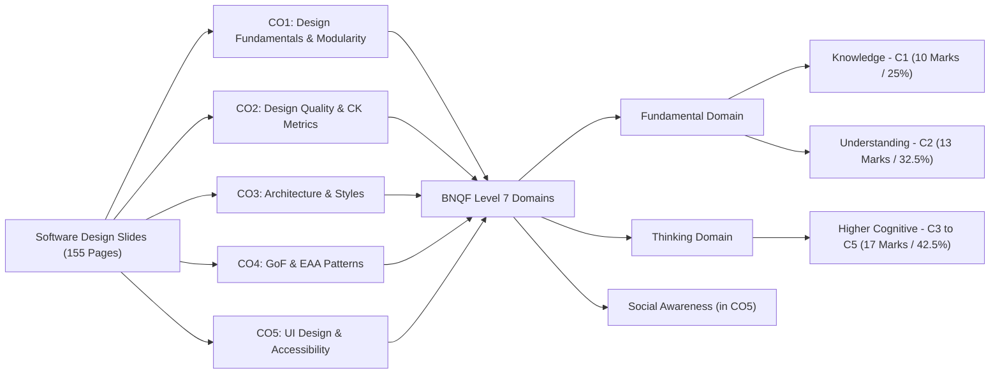

Here is a **student-voiced, interactive `README.md`** ready to copy and paste directly into your GitHub repository. It is written from the perspective of a Software Engineering student who studied the **Software Design** lecture slides (Pages 1–155) and built an **OBE / BNQF Level 7 self-assessment guide** featuring:

- Interactive **study checklists** (`- [ ]`) and a **Mermaid alignment diagram** (renders natively on GitHub).
- **Dynamic, real-world student scenarios** (Campus Canteen App, Hostel Smart Thermostat, AI Study Assistant, Note-Taking App, Library Portal).
- **Collapsible `<details>` walkthroughs** under every question showing **"How I Thought Through This (Student Approach)"** alongside the exam-ready solution.
- Full **Q-to-CO Mapping**, **Bloom's Taxonomy (`Knowledge`, `Understanding`, `Higher Cognitive`)**, **Table of Specifications (40 Marks | 1 Hr)**, and a **Self-Scoring CO Attainment Tracker**.

Copy everything inside the block below into your `README.md`:

````markdown
# 📐 Software Design — Student Study Notes & OBE Practice Assessment (BNQF Level 7)


> **Why I made this `README.md`:**  
> While studying the **Software Design** lecture slides (covering Design Fundamentals, CK Quality Metrics, Architectural Styles, GoF & Fowler's EAA Patterns, and UI Design), I wanted more than passive notes. So I mapped the entire 155-slide deck to **5 Software Engineering Course Outcomes (CO1–CO5)** under the **BNQF Level 7 (Bachelor's) OBE Standard**, built a timed **40-mark (1-hour) practice test**, and documented my own step-by-step student thought process inside expandable answers below.

---

## 🗺️ How Everything Connects (Slide Deck → COs → BNQF & Bloom's)



---

## 🎯 My 5 SE Course Outcomes (`CO1`–`CO5`) — BNQF Level 7 Aligned

| CO | What I Should Be Able To Do (Course Outcome) | Target Bloom's Levels | BNQF Level 7 Domain(s) | Slide Coverage | Prep Status |
| :--- | :--- | :--- | :--- | :--- | :---: |
| **CO1** | **Explain** software design fundamentals, design phases, and modular decomposition principles (coupling, cohesion, abstraction, encapsulation, information hiding) to organize maintainable software. | `C1`–`C4` | Fundamental (*Knowledge & Understanding*), Thinking (*Cognitive*) | Slides 2–14 | [ ] |
| **CO2** | **Apply** Chidamber & Kemerer (CK) OO quality metrics (`CBO`, `COF`, `LCOM`, `LCOM2`, `LCOM3`, `WMC`, `RFC`, `DIT`, `NOC`) to quantify and interpret class complexity and cohesion. | `C1`–`C5` | Fundamental (*Knowledge & Understanding*), Thinking (*Cognitive*) | Slides 15–29, 109–118 | [ ] |
| **CO3** | **Evaluate** software architecture structures and architectural styles (Layered, Event-Based, MVC, Blackboard/Repository, Pipes & Filters) to pick the right high-level layout for a system. | `C1`–`C5` | Fundamental (*Knowledge & Understanding*), Thinking (*Cognitive*) | Slides 30–39 | [ ] |
| **CO4** | **Apply** Gang of Four (GoF) design patterns (Creational, Structural, Behavioral) and Martin Fowler's EAA patterns (Domain/Service Layer, ORM/Inheritance Mapping, Presentation Logic) to real design bottlenecks. | `C1`–`C4` | Fundamental (*Knowledge & Understanding*), Thinking (*Cognitive*) | Slides 40–108, 119–146 | [ ] |
| **CO5** | **Analyze** user interface designs using core UI principles, interaction modalities, and inclusive presentation guidelines to improve usability for diverse users. | `C1`–`C5` | Fundamental (*Knowledge & Understanding*), Thinking (*Cognitive*), Social (*User Diversity*) | Slides 147–155 | [ ] |

---

## ✅ Pre-Test Study Checklist (Based on the Slides)

- [ ] **CO1:** Reviewed architectural vs. detailed design, recording design rationale, coupling spectrum (*Uncoupled → Content*), cohesion spectrum (*Coincidental → Functional*), and Parnas's information hiding.
- [ ] **CO2:** Practiced computing `CBO`, `COF`, `LCOM`, `LCOM2`, `LCOM3`, McCabe `WMC`, `RFC`, `DIT`, and `NOC` on small Java classes.
- [ ] **CO3:** Compared Layered, Event-Based, MVC, Blackboard/Repository, and Pipes & Filters styles.
- [ ] **CO4:** Reviewed GoF categories & patterns (*Parameterized Factory, Factory Method, Prototype, Singleton, Adapter, Composite, Façade, Decorator, Strategy, Template Method, Command, Observer*) + Fowler's EAA (*Domain Model, Service Layer, Data Mapper, Identity/FK/Association Mapping, Single/Class/Concrete Table Inheritance, MVC, Page/Front Controller, Template/Transform View*).
- [ ] **CO5:** Memorized the 7 UI design principles, 6 interaction modalities, and color-blindness accessibility rules.

---

## 📝 Timed OBE Practice Assessment (40 Marks | 1 Hour)

> **Student Rules I Followed:**
> - **Total Time:** `60 Minutes` (~`12 minutes` per 8-mark question, or ~`1.5 min/mark`).
> - **No Skipping Questions:** Under OBE/BNQF rules, every question is compulsory so all 5 COs are tested fairly.
> - **Try before expanding:** Write down your answer first, then open **"How I Thought Through This"** to check both the reasoning and the exact mark breakdown.

---

### Question 1 — Design Fundamentals & Modularity `[8 Marks | CO1]`

- **1.(a)** Define *abstraction* and *encapsulation / information hiding* (Parnas, 1972) in the context of modular software design.  
  `[2 Marks | CO1 | C1: Knowledge | BNQF: Fundamental – Knowledge]`

- **1.(b)** Suppose your capstone team skips writing design *rationale* and jumps straight to coding. Explain **(i)** the difference between *architectural design* and *detailed design*, and **(ii)** why documenting the *rationale* behind nontrivial decisions improves long-term maintainability.  
  `[3 Marks | CO1 | C2: Understanding | BNQF: Fundamental – Understanding]`

- **1.(c)** While doing a peer code review on a **Campus Canteen Ordering App**, you notice two modules:
  - **`OrderPipeline`:** Calls `takeOrder()`, sends its result directly to `calculateBill()`, and sends that output to `generateReceipt()`.
  - **`StuffModule`:** Packs `playNotificationSound()`, `connectMySQL()`, and `formatStudentName()` into one helper class.
  
  Classify the **cohesion** type (*Coincidental, Logical, Temporal, Procedural, Communicational, Sequential,* or *Functional*) of each module and justify why one is a much cleaner modular split than the other.  
  `[3 Marks | CO1 | C4: Analyze | BNQF: Thinking – Cognitive]`

<details>
<summary>💡 Click to expand: How I Thought Through Q1 + Model Answer (8 Marks)</summary>

**Student Thought Process:**
1. *For 1(a) [Knowledge]:* Recall Slide 14—don't mix up abstraction and encapsulation! **Abstraction** is *what view you expose* (keeping only purpose-relevant details), while **encapsulation/information hiding** is *locking away* internal implementation details from outsiders.
2. *For 1(b) [Understanding]:* Think high-level vs. low-level (Slide 6): architecture = boxes/components and organization; detailed design = internal behavior inside each box. For rationale (Slide 8), future teammates (or future me!) won't accidentally break an intentional workaround if the *why* is recorded.
3. *For 1(c) [Cognitive - Analyze]:* Use the cohesion ladder from Slide 13 (`Coincidental < Logical < Temporal < Procedural < Communicational < Sequential < Functional`). Data flowing from one step's output to the next step's input = **Sequential**. Random unrelated helper functions dumped together = **Coincidental**.

**Model Answer & Mark Breakdown:**
- **1.(a) [2 Marks]:**
  - *Abstraction* [1]: A view of an object that focuses on information relevant to a particular purpose and ignores the remaining details.
  - *Encapsulation & Information Hiding* [1]: Grouping and packaging the internal details of an abstraction and making those details inaccessible to external entities.
- **1.(b) [3 Marks]:**
  - *Architectural design* [1]: High-level (top-level) design describing how software is organized into components.
  - *Detailed design* [1]: Specifies the desired internal behavior of those components.
  - *Rationale value* [1]: Recording the reasoning behind nontrivial decisions inside design models/artifacts prevents blind modifications later and enhances long-term maintainability.
- **1.(c) [3 Marks]:**
  - `OrderPipeline` exhibits **Sequential cohesion** [1] because the output of one operation (`takeOrder()` → `calculateBill()` → `generateReceipt()`) serves as the input to the next.
  - `StuffModule` exhibits **Coincidental cohesion** [1] because its elements have no meaningful relationship to one another.
  - *Justification* [1]: Sequential cohesion sits near the top of the cohesion spectrum (strong association, easier to understand, test, and maintain), whereas coincidental cohesion is the weakest split and creates messy dependencies.

</details>

---

### Question 2 — Software Design Quality & OO Metrics `[8 Marks | CO2]`

- **2.(a)** State the definitions of **Coupling Between Object classes (`CBO`)** and **Request For a Class (`RFC`)** in the Chidamber & Kemerer (CK) metrics suite, mentioning what relationships or calls are normally excluded when counting them.  
  `[2 Marks | CO2 | C1: Knowledge | BNQF: Fundamental – Knowledge]`

- **2.(b)** In a **Hostel Smart-Room IoT** project, you wrote the Java class below (assume `Heater` and `CoolingFan` are classes in your own project):

  ```java
  class SmartThermostat {
      private double currentTemp;
      private double targetTemp;
      private Heater heater;
      private CoolingFan fan;

      public SmartThermostat(Heater h, CoolingFan f) {
          currentTemp = 22.0;
          targetTemp = 22.0;
          heater = h;
          fan = f;
      }

      public void setTargetTemp(double t) {
          targetTemp = t;
      }

      public void regulate() {
          if (currentTemp < targetTemp) {
              if (heater != null) heater.turnOn();
              if (fan != null) fan.turnOff();
          } else {
              if (heater != null) heater.turnOff();
              if (fan != null) fan.turnOn();
          }
      }
  }
  ```

  Compute the following metrics (show your intermediate steps):
  1. McCabe's version of **Weighted Methods per Class (`WMC`)** `[2 Marks]`
  2. **Lack of Cohesion of Methods 2 (`LCOM2`)**, where $LCOM2(x) = 1 - \frac{\sum ma_i}{m \cdot a}$ `[2 Marks]`  
  `[Total: 4 Marks | CO2 | C3: Apply | BNQF: Thinking – Cognitive]`

- **2.(c)** Interpret what your `LCOM2` score says about `SmartThermostat`'s cohesion quality, and explain why getting `LCOM3 > 1` (where $LCOM3 = \frac{m - \sum ma_i / a}{m - 1}$) means a class contains **"dead attributes."**  
  `[2 Marks | CO2 | C2: Understanding | BNQF: Fundamental – Understanding]`

<details>
<summary>💡 Click to expand: How I Thought Through Q2 + Model Answer (8 Marks)</summary>

**Student Thought Process:**
1. *Watch out for slide conventions!* Looking back at Slide 26 (`Rectangle`) and Slide 29 (`Controller`), **constructors count as methods** when calculating `WMC`, `RFC`, `LCOM2`, and `LCOM3`!
2. *For McCabe `WMC`:* Formula is `(number of conditions + 1)` per method, summed across all methods. Remember from Slide 29: an `else` keyword by itself does **not** add a condition—only `if`, `for`, `while` (or `switch` cases converted to `if`) do! Let's count carefully:
   - `SmartThermostat(...)`: 0 conditions → `1`
   - `setTargetTemp(...)`: 0 conditions → `1`
   - `regulate()`: 5 `if` statements → `5 + 1 = 6`
3. *For `LCOM2`:* There are $m = 3$ methods and $a = 4$ attributes. Check which methods touch each attribute (`ma_i`). Remember the constructor initializes all 4!
4. *For `LCOM3 > 1`:* Play with the algebra! If every attribute is used at least once ($ma_i \ge 1$), then $\sum ma_i \ge a \implies \frac{\sum ma_i}{a} \ge 1 \implies m - \frac{\sum ma_i}{a} \le m - 1 \implies LCOM3 \le 1$. So the *only* way to break past `1` is if $\frac{\sum ma_i}{a} < 1$, which forces at least one attribute to have $ma_i = 0$ (never used = dead attribute!).

**Model Answer & Mark Breakdown:**
- **2.(a) [2 Marks]:**
  - `CBO(A)` [1]: Number of classes used by class `A`; **inheritance** relationships are typically excluded.
  - `RFC(A) = M + R` [1]: Number of local methods (`M`) plus number of methods called by `A`'s methods (`R`, counting each distinct method once); **standard API/library calls** are normally excluded (only same-project methods are counted).
- **2.(b) [4 Marks]:**
  1. **McCabe `WMC` [2 Marks]:**
     - $C_{\text{SmartThermostat}} = 0 + 1 = 1$
     - $C_{\text{setTargetTemp}} = 0 + 1 = 1$
     - $C_{\text{regulate}} = 5\text{ (`if` conditions)} + 1 = 6$ [1]
     - $\text{WMC}(\text{SmartThermostat}) = 1 + 1 + 6 = 8$ [1]
  2. **`LCOM2` [2 Marks]:**
     - $m = 3$ methods, $a = 4$ attributes
     - $ma_{\text{currentTemp}} = 2$ (constructor, `regulate`)
     - $ma_{\text{targetTemp}} = 3$ (constructor, `setTargetTemp`, `regulate`)
     - $ma_{\text{heater}} = 2$ (constructor, `regulate`)
     - $ma_{\text{fan}} = 2$ (constructor, `regulate`)
     - $\sum ma_i = 2 + 3 + 2 + 2 = 9$ [1]
     - $LCOM2 = 1 - \frac{9}{3 \times 4} = 1 - \frac{9}{12} = 0.25$ [1]
- **2.(c) [2 Marks]:**
  - *Cohesion interpretation* [1]: Since `LCOM2` ranges from `0` (perfect cohesion) to `1` (worst cohesion) and smaller values are better, `0.25` shows good/strong cohesion across the class's methods and attributes.
  - *Why `LCOM3 > 1` implies dead attributes* [1]: For $\frac{m - \sum ma_i / a}{m - 1} > 1$, we must have $\frac{\sum ma_i}{a} < 1$ (average methods per attribute $< 1$), which is only possible when at least one attribute is unused by any method ($ma_i = 0$ — a "dead attribute").

</details>

---

### Question 3 — Software Architecture & Architectural Styles `[8 Marks | CO3]`

- **3.(a)** State the strict definition of *software architecture* (Clements et al., 2010) and name any **two** architectural styles from Garlan & Shaw's classification.  
  `[2 Marks | CO3 | C1: Knowledge | BNQF: Fundamental – Knowledge]`

- **3.(b)** Using a **University Course Registration Web App** as an example, explain the distinct responsibilities of the **Model**, **View**, and **Controller** in the **MVC** style, and identify which two components together form the User Interface (UI).  
  `[3 Marks | CO3 | C2: Understanding | BNQF: Fundamental – Understanding]`

- **3.(c)** *Real-World Scenario:* Your senior design team is building an **AI Study-Assistant & Assignment Analyzer** with five independent engines (`ks1`–`ks5`: OCR scanner, grammar analyzer, plagiarism checker, citation verifier, and grade estimator). Each engine works independently and asynchronously reads/writes partial findings to a central shared document state without calling the other engines directly.  
  Recommend the most suitable **architectural style**, justify why it is better than a **Layered architecture** here, and describe how the components interact.  
  `[3 Marks | CO3 | C5: Evaluate | BNQF: Thinking – Cognitive]`

<details>
<summary>💡 Click to expand: How I Thought Through Q3 + Model Answer (8 Marks)</summary>

**Student Thought Process:**
1. *For 3(a):* Recall Clements et al. (Slide 32): *structures*, *elements*, *relations*, and *properties*. For styles (Slides 35–39), pick any two: *Layered, Event-Based, MVC, Blackboard/Repository, Pipes and Filters*.
2. *For 3(b):* In Course Registration (Slide 37): `Course`/`Student` enrollment rules live in the **Model**; the HTML timetable/registration form is the **View**; the handler taking "Enroll" clicks, updating the model, and triggering view refresh is the **Controller**. Key slide fact: **UI = View + Controller**.
3. *For 3(c):* Notice the clues: independent knowledge sources (`ks1`–`ks5`), shared central data, no direct calls between engines. In a **Layered** style (Slide 35), each layer depends strictly on the layer below it—that forces a rigid vertical chain. **Blackboard / Repository** (Slide 38) puts shared data in the middle so independent knowledge sources compute directly against it!

**Model Answer & Mark Breakdown:**
- **3.(a) [2 Marks]:**
  - *Definition* [1]: Software architecture is the set of structures needed to reason about the system, comprising software elements, relations among them, and properties of both.
  - *Any two styles* [1]: e.g., **Layered**, **Event-Based**, **MVC**, **Blackboard/Repository**, or **Pipes and Filters**.
- **3.(b) [3 Marks]:**
  - **Model** [1]: Represents domain data/state and rules (e.g., student enrollment, course seats).
  - **View** & **Controller** [1]: View displays the model in the UI (e.g., timetable/course list); Controller handles user input (e.g., clicking "Register"), manipulates the model, and causes the view to update.
  - **UI Composition** [1]: The **View** and **Controller** together form the User Interface (UI).
- **3.(c) [3 Marks]:**
  - *Recommendation* [1]: **Blackboard / Repository** architectural style.
  - *Why better than Layered* [1]: A Layered architecture restricts dependencies so each layer only talks to the layer immediately below it, which does not suit independent, parallel/opportunistic analyzers (`ks1`–`ks5`) that shouldn't depend on one another.
  - *Interaction mechanism* [1]: Each knowledge source (`ks1`–`ks5`) maintains direct bidirectional access to read from and write computation results back to the central **Blackboard** (shared data memory).

</details>

---

### Question 4 — GoF & Enterprise Application Architecture Patterns `[8 Marks | CO4]`

- **4.(a)** List the **three** classification categories of Gang of Four (GoF) design patterns and give **one** example pattern for each category from the course slides.  
  `[2 Marks | CO4 | C1: Knowledge | BNQF: Fundamental – Knowledge]`

- **4.(b)** Suppose your university portal has a `User` superclass with `StudentUser` and `FacultyUser` subclasses. Compare **Single Table Inheritance** vs. **Class Table Inheritance** for mapping them to a relational database, stating **one advantage** and **one disadvantage** of each.  
  `[2 Marks | CO4 | C2: Understanding | BNQF: Fundamental – Understanding]`

- **4.(c)** You are developing a **Note-Taking & PDF Export App** and hit two engineering roadblocks:
  1. Users want to toggle features like *SpellCheck*, *DarkBorder*, and *ScrollPane* onto a `TextView` dynamically at runtime—creating subclasses for every combination would cause a class explosion. `[2 Marks]`
  2. You must integrate a third-party `ExternalPdfEngine` library whose method `exportBytes(byte[])` is incompatible with your app's `DocumentRenderer.render()` interface, and you cannot modify the third-party code. `[2 Marks]`
  
  Identify the exact **GoF design pattern** for each problem and explain how its key wrapper/adapter class solves it structurally.  
  `[Total: 4 Marks | CO4 | C3: Apply | BNQF: Thinking – Cognitive]`

<details>
<summary>💡 Click to expand: How I Thought Through Q4 + Model Answer (8 Marks)</summary>

**Student Thought Process:**
1. *For 4(a):* Slide 44 table! Three columns: **Creational** (*Factory Method, Abstract Factory, Builder, Prototype, Singleton*), **Structural** (*Adapter, Bridge, Composite, Decorator, Flyweight, Facade, Proxy*), **Behavioral** (*Strategy, Template Method, Command, Observer, etc.*).
2. *For 4(b):* Slides 97–100!
   - **Single Table:** One big `users` table with `type`, `cgpa`, `office_room`... Fast (no joins!), easy to move fields up/down, *but* lots of `NULL`s / wasted space and a huge table.
   - **Class Table:** Separate `users`, `student_users`, `faculty_users` tables linked by FK. Zero wasted columns and clean 1-to-1 domain mapping, *but* loading an object requires joins/multiple queries and hierarchy refactoring alters the DB schema.
3. *For 4(c):*
   - Roadblock 1 = adding behaviors dynamically at runtime via wrapping instead of static inheritance → **Decorator** (Slides 136–140).
   - Roadblock 2 = converting an incompatible interface without changing existing code → **Object Adapter** (Slides 58–60).

**Model Answer & Mark Breakdown:**
- **4.(a) [2 Marks]:**
  - **Creational** (e.g., *Factory Method*, *Singleton*, *Prototype*), **Structural** (e.g., *Adapter*, *Composite*, *Decorator*, *Façade*), **Behavioral** (e.g., *Strategy*, *Template Method*, *Command*, *Observer*) [1 mark for all 3 categories, 1 mark for valid example in each].
- **4.(b) [2 Marks]:**
  - **Single Table Inheritance** [1]: Stores the entire hierarchy in one table. *Advantage:* No joins needed and moving fields up/down doesn't change the DB. *Disadvantage:* Unused columns cause wasted space, irrelevant fields, and an oversized table.
  - **Class Table Inheritance** [1]: Creates one table per class linked via foreign keys. *Advantage:* Every column is relevant (no wasted space) with a straightforward domain-to-DB mapping. *Disadvantage:* Requires SQL joins/multiple queries to load objects, and field refactoring triggers DB schema changes.
- **4.(c) [4 Marks]:**
  1. **Decorator Pattern** [1]: The `Decorator` class conforms to the `VisualComponent` (`Component`) interface while holding a reference to a wrapped `Component` (`TextView` or another decorator). Concrete decorators (`ScrollDecorator`, `BorderDecorator`, etc.) override `Draw()` to delegate to the wrapped component and dynamically attach extra features at runtime [1].
  2. **Object Adapter Pattern** (or **Adapter**) [1]: The `Adapter` class implements the app's `Target` interface (`DocumentRenderer` with `render()`), wraps an instance of `Adaptee` (`ExternalPdfEngine`), and translates `render()` calls into `adaptee.exportBytes(...)` without altering `ExternalPdfEngine` [1].

</details>

---

### Question 5 — User Interface Design & Accessibility `[8 Marks | CO5]`

- **5.(a)** List any **four** fundamental UI design principles and any **two** UI interaction modalities covered in the slides.  
  `[2 Marks | CO5 | C1: Knowledge | BNQF: Fundamental – Knowledge]`

- **5.(b)** Explain why UI designers must not rely on **color alone** to communicate critical system status, and describe **two** color-presentation guidelines that support users with color blindness or visual impairments.  
  `[3 Marks | CO5 | C2: Understanding | BNQF: Fundamental – Understanding]`

- **5.(c)** *UI Audit Challenge:* You are reviewing a **Campus Library Admin Portal** with the following issues:
  - It displays 35 ungrouped input fields labeled with cryptic internal database codes (`BK_STAT_CD`, `MBR_TYP`).
  - Clicking "Delete" immediately erases a book record with no confirmation dialog or undo option.
  - Overdue book returns are signaled solely by switching a tiny dot from green to red.
  
  Identify **three distinct UI design or presentation violations** (naming the violated principle/guideline) and propose a concrete fix for each.  
  `[3 Marks | CO5 | C4: Analyze | BNQF: Thinking – Cognitive]`

<details>
<summary>💡 Click to expand: How I Thought Through Q5 + Model Answer (8 Marks)</summary>

**Student Thought Process:**
1. *For 5(a):* Recall the 7 principles on Slides 149–150 (*Learnability, User familiarity, Consistency, Minimal surprise, Recoverability, User guidance, User diversity*) and 6 modalities on Slides 152–153 (*Question-answer, Direct manipulation, Menu selection, Form fill-in, Command language, Natural language*).
2. *For 5(b):* Connect **User diversity** (Slide 150) to **UI information presentation** (Slide 155): colorblind or low-vision users cannot distinguish color-only cues. Concrete slide tips: avoid green–red pairs, vary saturation and brightness, limit total colors, and always pair color with non-color cues (text/icons).
3. *For 5(c):* Notice this mirrors the funny *"YOUR COMPANY'S APP..."* cartoon on Slides 149–155! Break it into 3 neat pairs of *(Violation → Principle → Concrete Fix)*.

**Model Answer & Mark Breakdown:**
- **5.(a) [2 Marks]:**
  - *Any 4 principles* [1]: Learnability, User familiarity, Consistency, Minimal surprise, Recoverability, User guidance, User diversity.
  - *Any 2 modalities* [1]: Question-answer, Direct manipulation, Menu selection, Form fill-in, Command language, Natural language.
- **5.(b) [3 Marks]:**
  - *Why not color alone* [1]: Under **User diversity**, users with color blindness, color deficiency, or poor eyesight cannot reliably perceive status conveyed solely by color.
  - *Two presentation guidelines* [2]: (1) Avoid **green and red combinations**, using changes in **color saturation and brightness** instead [1]; (2) Limit the total number of colors and pair consistent color-coding with non-color cues such as text labels or icons [1].
- **5.(c) [3 Marks]:**
  1. **User familiarity & Learnability** [1]: Raw DB codes (`BK_STAT_CD`, `MBR_TYP`) and 35 ungrouped boxes confuse users → *Fix:* Use familiar domain labels (e.g., *"Book Status"*, *"Member Type"*) and group related fields cleanly.
  2. **Recoverability & Minimal surprise** [1]: Instant irreversible deletion prevents error recovery and surprises the user → *Fix:* Add a confirmation dialog and an *Undo* / soft-delete recovery mechanism.
  3. **User diversity & UI color presentation** [1]: A green-to-red-only dot fails colorblind users → *Fix:* Replace green-red-only encoding with high-contrast brightness/saturation plus an explicit text badge/icon (e.g., `[!] OVERDUE`).

</details>

---

## 📊 Question-to-CO, Bloom's & BNQF Mapping Matrix

| Q. No. | Assessed Topic | Marks | Mapped CO | Bloom's Cognitive Level | Category (`Knowledge / Understanding / Cognitive`) | BNQF Level 7 Domain |
| :---: | :--- | :---: | :---: | :--- | :--- | :--- |
| **1.(a)** | Abstraction & Encapsulation | 2 | **CO1** | `C1` – Remember | **Knowledge** (LOTS) | Fundamental (*Knowledge*) |
| **1.(b)** | Design Phases & Rationale | 3 | **CO1** | `C2` – Understand | **Understanding** (LOTS) | Fundamental (*Understanding*) |
| **1.(c)** | Cohesion Analysis (`OrderPipeline` vs `StuffModule`) | 3 | **CO1** | `C4` – Analyze | **Cognitive** (HOTS) | Thinking (*Cognitive*) |
| **2.(a)** | `CBO` & `RFC` Definitions | 2 | **CO2** | `C1` – Remember | **Knowledge** (LOTS) | Fundamental (*Knowledge*) |
| **2.(b)** | Computing `WMC` & `LCOM2` | 4 | **CO2** | `C3` – Apply | **Cognitive** (HOTS) | Thinking (*Cognitive*) |
| **2.(c)** | Interpreting `LCOM2` & `LCOM3 > 1` | 2 | **CO2** | `C2` – Understand | **Understanding** (LOTS) | Fundamental (*Understanding*) |
| **3.(a)** | Architecture Definition & Styles | 2 | **CO3** | `C1` – Remember | **Knowledge** (LOTS) | Fundamental (*Knowledge*) |
| **3.(b)** | MVC Responsibilities & UI | 3 | **CO3** | `C2` – Understand | **Understanding** (LOTS) | Fundamental (*Understanding*) |
| **3.(c)** | Selecting Architectural Style | 3 | **CO3** | `C5` – Evaluate | **Cognitive** (HOTS) | Thinking (*Cognitive*) |
| **4.(a)** | GoF Pattern Categories | 2 | **CO4** | `C1` – Remember | **Knowledge** (LOTS) | Fundamental (*Knowledge*) |
| **4.(b)** | Single vs. Class Table Inheritance | 2 | **CO4** | `C2` – Understand | **Understanding** (LOTS) | Fundamental (*Understanding*) |
| **4.(c)** | Applying Decorator & Object Adapter | 4 | **CO4** | `C3` – Apply | **Cognitive** (HOTS) | Thinking (*Cognitive*) |
| **5.(a)** | UI Principles & Modalities | 2 | **CO5** | `C1` – Remember | **Knowledge** (LOTS) | Fundamental (*Knowledge*) |
| **5.(b)** | Color & Accessibility Rules | 3 | **CO5** | `C2` – Understand | **Understanding** (LOTS) | Fundamental (*Understanding*) / Social |
| **5.(c)** | Auditing UI Design Violations | 3 | **CO5** | `C4` – Analyze | **Cognitive** (HOTS) | Thinking (*Cognitive*) / Social |
| **Total** | | **40** | **CO1–CO5** | **`C1`–`C5`** | **Knowledge + Understanding + Higher Cognitive** | **BNQF Level 7 Compliant** |

---

## 📋 Table of Specifications (ToS) — Marks & Bloom's Distribution

| Course Outcome | Knowledge (`C1`) | Understanding (`C2`) | Cognitive: Apply (`C3`) | Cognitive: Analyze (`C4`) | Cognitive: Evaluate (`C5`) | Total Marks | Weightage |
| :--- | :---: | :---: | :---: | :---: | :---: | :---: | :---: |
| **CO1** | 2 | 3 | 0 | 3 | 0 | **8** | 20.0% |
| **CO2** | 2 | 2 | 4 | 0 | 0 | **8** | 20.0% |
| **CO3** | 2 | 3 | 0 | 0 | 3 | **8** | 20.0% |
| **CO4** | 2 | 2 | 4 | 0 | 0 | **8** | 20.0% |
| **CO5** | 2 | 3 | 0 | 3 | 0 | **8** | 20.0% |
| **Total** | **10** | **13** | **8** | **6** | **3** | **40** | **100%** |
| **Share (%)** | **25.0%** *(Knowledge)* | **32.5%** *(Understanding)* | **42.5%** *(Higher Cognitive: C3–C5)* ||| **40** | **100%** |

---

## 📈 My Self-Test Score & CO Attainment Log

After finishing the 60-minute test, log your marks below (target OBE mastery threshold: **≥ 5 / 8 [62.5%]** per CO):

| Question | Mapped CO | Max Marks | My Score | Target Achieved? (`>= 5`) | What I Need to Revisit |
| :---: | :---: | :---: | :---: | :---: | :--- |
| **Q1** | CO1 | 8 | `__/8` | [ ] | *e.g., Cohesion hierarchy (Slide 13)* |
| **Q2** | CO2 | 8 | `__/8` | [ ] | *e.g., Counting McCabe `if`s / `LCOM2` (Slides 23–29)* |
| **Q3** | CO3 | 8 | `__/8` | [ ] | *e.g., Blackboard vs Layered style (Slides 35–38)* |
| **Q4** | CO4 | 8 | `__/8` | [ ] | *e.g., Decorator vs Adapter & EAA ORM (Slides 58–60, 97–100, 136–140)* |
| **Q5** | CO5 | 8 | `__/8` | [ ] | *e.g., UI Principles & Color Accessibility (Slides 149–155)* |
| **Total** | **CO1–CO5** | **40** | **`__/40`** | **Target: ≥ 25/40** | |

---

### 📚 Slide References Followed
- **Software Design Slides** (`www.cs.uoi.gr/~zarras/se.htm`) synthesizing material from Pfleeger, Sommerville, IEEE SWEBOK v3, R. C. Martin, Gang of Four (1995), Martin Fowler (EAA Patterns), Stevens/Myers/Constantine (1974), Parnas (1972), Chidamber & Kemerer, Clements et al. (2010), and Garlan & Shaw (1993).
````

If you want me to tailor the repo title, course code, university name, or add a live `README.md` file inside a specific folder for you, let me know!
