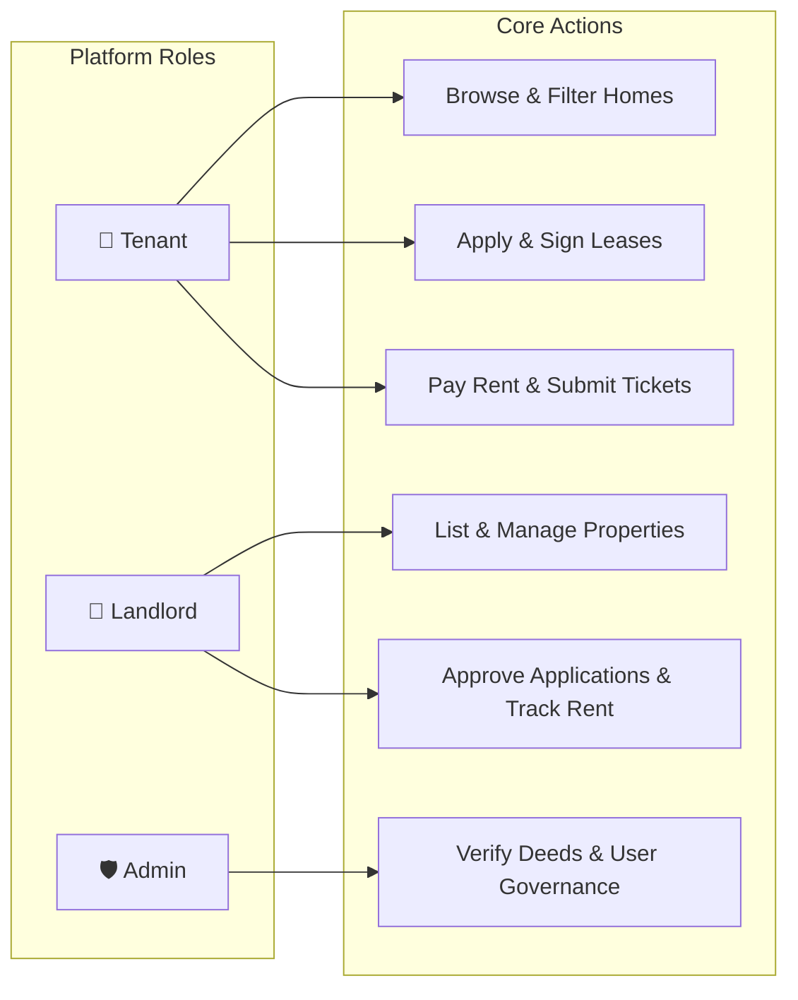
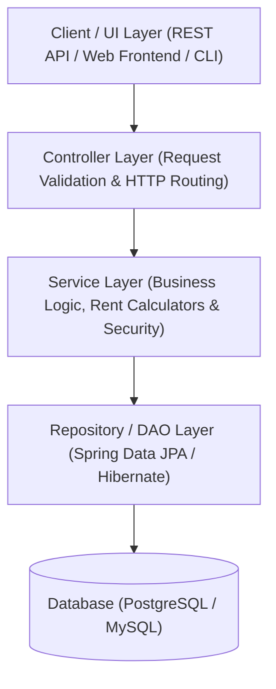
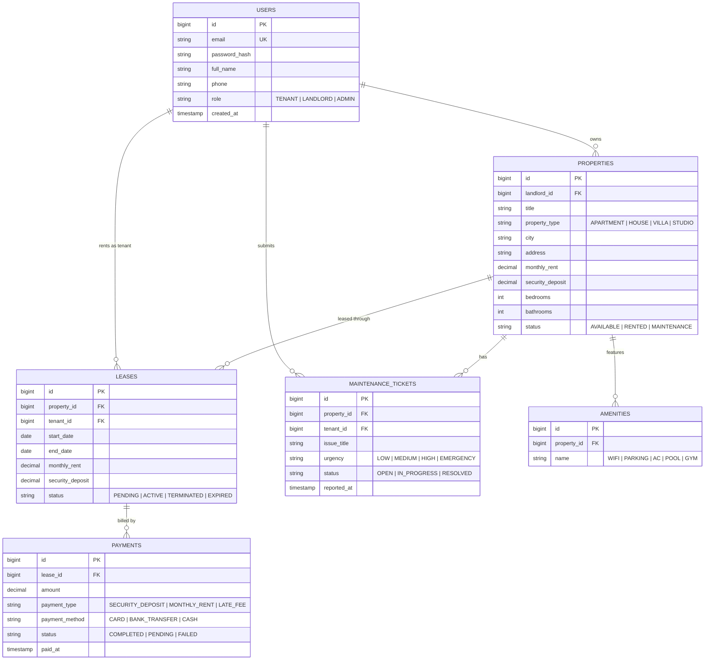

# 🏠 House Rental Management System (HRMS)

[](https://openjdk.org/)
[](https://spring.io/projects/spring-boot)
[](https://www.postgresql.org/)
[](https://maven.apache.org/)
[](#-system-architecture)

A clean, modern, and extensible **House Rental Management System** built in **Java**. Designed with industry-standard Object-Oriented Programming (OOP) principles and clean architecture, this project seamlessly connects **Tenants**, **Landlords (Property Owners)**, and **Administrators** to manage property listings, rental applications, digital lease agreements, payments, and maintenance requests.

---

## 📌 Table of Contents
1. [Overview](#-overview)
2. [What Makes This System Dynamic?](#-what-makes-this-system-dynamic)
3. [User Roles & Permissions](#-user-roles--permissions)
4. [System Architecture](#-system-architecture)
5. [Database Model (ERD)](#-database-model-erd)
6. [Design Patterns Used](#-design-patterns-used)
7. [Project Directory Structure](#-project-directory-structure)
8. [End-to-End Workflow](#-end-to-end-workflow)
9. [Quick Start & Setup](#-quick-start--setup)
10. [Roadmap & Future Enhancements](#-roadmap--future-enhancements)

---

## 🌟 Overview

Finding and managing rental homes is often chaotic with paper contracts, unorganized WhatsApp chats, and lost payment receipts. 

**HRMS solves this by providing a unified, automated platform:**
- **Tenants** can search available homes, filter by budget/city/amenities, sign digital lease agreements, and pay rent online.
- **Landlords** can list apartments/villas/studios, screen applicants, track monthly earnings, and handle maintenance tickets.
- **Admins** maintain platform integrity by verifying property deeds and overseeing dispute resolutions.

---

## ⚡ What Makes This System Dynamic?

| Feature | How It Works |
| :--- | :--- |
| 🔍 **Multi-Criteria Search Engine** | Filter dynamically by city, price range (`min`-`max`), property type, bedrooms, pet policy, and amenities. |
| 🧮 **Automated Prorated Rent & Invoicing** | Mid-month move-ins automatically calculate exact day-based prorated rent. Monthly invoices generate on the 1st of every month. |
| 🔒 **Zero Double-Booking Protection** | Transactions and database constraints ensure no two tenants can reserve the same property for overlapping dates. |
| 💳 **Pluggable Payment Processing** | Strategy design pattern allows switching between Credit Card, Bank Transfer, PayPal, or Cash without changing core code. |
| 🛠️ **Full Maintenance Ticket Lifecycle** | Tenants report issues with photos and urgency levels; landlords assign technicians and track resolution status (`OPEN` ➔ `IN_PROGRESS` ➔ `RESOLVED`). |

---

## 👥 User Roles & Permissions



- **🧑 Tenant:** Search properties, schedule viewings, submit rental applications, sign digital leases, make payments, and submit maintenance tickets.
- **👨 Landlord:** Post and edit property listings, review tenant applications, create custom lease terms, monitor rent payments, and resolve maintenance issues.
- **🛡️ Admin:** Review and verify landlord identity/deed documents, oversee platform accounts, manage disputes, and view system analytics.

---

## 🏗️ System Architecture

The application is structured into four clean, decoupled layers:



---

## 🗄️ Database Model (ERD)

A clean relational schema connecting users, homes, leases, payments, and maintenance requests:



---

## 🧩 Design Patterns Used

Writing clean Java requires good design patterns. This project implements:

1. **Strategy Pattern (Payments):**  
   Enables multiple checkout methods (`CreditCardPaymentStrategy`, `BankTransferStrategy`, `PayPalStrategy`) under a common `PaymentStrategy` interface.
2. **Factory Pattern (Property & Notification Creation):**  
   A `PropertyFactory` instantiates properties (`Apartment`, `SingleFamilyHouse`, `Villa`) based on dynamic inputs. A `NotificationFactory` routes alerts via Email or SMS.
3. **Builder Pattern (Leases):**  
   A `LeaseAgreementBuilder` constructs complex contracts with optional clauses, dates, deposits, and pet riders cleanly.
4. **Observer Pattern (System Events):**  
   When a lease becomes active or rent is due, registered observers automatically trigger email receipts, landlord notices, and invoice generation.

---

## 📁 Project Directory Structure

```text
HouseRentalSystem/
├── pom.xml                               # Maven dependencies and build plugins
├── README.md                             # Project documentation
│
└── src/
    ├── main/
    │   ├── java/com/houserental/
    │   │   ├── HouseRentalApplication.java       # Main entry point
    │   │   │
    │   │   ├── config/                           # Database & Security configs
    │   │   ├── controller/                       # REST API endpoints / CLI controllers
    │   │   ├── dto/                              # Request & Response objects (DTOs)
    │   │   ├── entity/                           # JPA Database Entities (User, Property, Lease)
    │   │   │   └── enums/                        # Role, PropertyType, LeaseStatus
    │   │   ├── exception/                        # Custom errors & Global Exception Handler
    │   │   ├── patterns/                         # Factory, Strategy, Builder classes
    │   │   ├── repository/                       # Spring Data JPA Repository interfaces
    │   │   ├── service/                          # Core business logic services
    │   │   └── util/                             # Password encoder, date & rent calculators
    │   │
    │   └── resources/
    │       ├── application.properties            # DB credentials & server settings
    │       ├── schema.sql                        # Database tables creation script
    │       └── data.sql                          # Sample mock properties & users
    │
    └── test/
        └── java/com/houserental/                 # JUnit 5 & Mockito test suites
            ├── service/                          # Unit tests for rent & lease logic
            └── repository/                       # Integration tests with H2 database
```

---

## 🔄 End-to-End Workflow

```text
1. DISCOVER ───► Tenant searches by city, price range, and bedrooms.
2. APPLY    ───► Tenant selects home, reviews terms, and submits rental request.
3. APPROVE  ───► Landlord reviews tenant profile and clicks "Approve".
4. LEASE    ───► System generates digital lease agreement; both parties sign.
5. PAY      ───► Tenant pays security deposit & first month's rent online.
6. OCCUPY   ───► Property status flips to "RENTED"; tenant receives key instructions.
7. MAINTAIN ───► Tenant reports any repair issues via tickets until lease checkout.
```

---

## 🚀 Quick Start & Setup

### Prerequisites
- **JDK 17** or **21 LTS** (`java -version`)
- **Maven 3.8+** (`mvn -version`)
- Any modern IDE: **IntelliJ IDEA**, **Eclipse**, or **VS Code**
- **MySQL / PostgreSQL** (or run with zero setup using the built-in **H2 in-memory database**)

### Running Locally

```bash
# 1. Clone the project or navigate to the directory
cd HouseRentalSystem

# 2. Build the project & run unit tests
mvn clean compile

# 3. Launch the application
mvn spring-boot:run
```

> [!TIP]
> By default, the application runs on **`http://localhost:8080`**. If configured as a REST API, you can view the interactive API docs at **`http://localhost:8080/swagger-ui.html`**.

---

## 🗺️ Roadmap & Future Enhancements

- [x] Core OOP Domain Models & Clean Database Architecture
- [x] Multi-criteria Search & Filter Engine
- [x] Automated Prorated Rent & Invoice Calculations
- [ ] Integration with Payment Gateways (Stripe / PayPal)
- [ ] Automated PDF Lease Agreement generator (using OpenPDF)
- [ ] Interactive Google Maps / OpenStreetMap property pins
- [ ] Tenant & Landlord 2-way star review system
