# 🏠 RentSphere: Enterprise House Rental & Property Leasing System
### A Secure, Role-Based Platform for Multi-Property Listings, Dynamic Lease Management, Escrow Payments, and Automated Maintenance Dispatching

> **Course Title:** Software Engineering and Project Management  
> **Course Code:** ICT-3107
> **Project Type:** Comprehensive Capstone & Enterprise Application Architecture  
> **Target Platform:** Web Application (Next.js 14+ Frontend, Java 21+ / Spring Boot 3 Backend, PostgreSQL 16+)

---

## 📑 Table of Contents
1. [Executive Summary](#1-executive-summary)
2. [Problem Statement](#2-problem-statement)
3. [Proposed Solution and Workflow](#3-proposed-solution-and-workflow)
4. [Objectives](#4-objectives)
5. [Scope and Limitations](#5-scope-and-limitations)
6. [Users, Roles, and Permission Matrix](#6-users-roles-and-permission-matrix)
7. [Functional Requirements (FR)](#7-functional-requirements)
8. [Non-Functional Requirements (NFR)](#8-non-functional-requirements)
9. [Technology Stack and Architectural Justification](#9-technology-stack-and-architectural-justification)
10. [Software Process Model](#10-software-process-model)
11. [System Architecture](#11-system-architecture)
12. [UML and Behavioral Diagrams](#12-uml-and-behavioral-diagrams)
    - 12.1 Data Flow Diagrams (DFD Level 0 & Level 1)
    - 12.2 Use Case Diagram
    - 12.3 Activity Diagram — Property Booking & Lease Execution
    - 12.4 Entity Relationship Diagram (ERD)
    - 12.5 Class Diagram
    - 12.6 Object Diagram (Runtime Snapshot)
    - 12.7 State Machine Diagram — Lease & Booking Lifecycle
    - 12.8 Sequence Diagram — High-Concurrency Booking with Escrow Payment
13. [Key Technical Design Decisions](#13-key-technical-design-decisions)
    - 13.1 Concurrency & Double-Booking Prevention (PostgreSQL GiST Range Exclusion)
    - 13.2 Dynamic Pricing & Prorated Rent Engine
    - 13.3 Escrow Security Deposit & Refund Calculation Engine
    - 13.4 Idempotent Webhook & Payment Verification Architecture
    - 13.5 Extensible Gang-of-Four Design Patterns
    - 13.6 Fine-Grained Role & Ownership-Based Authorization
14. [Database Design & Integrity Constraints](#14-database-design--integrity-constraints)
15. [User Interface Plan & Wireframes](#15-user-interface-plan--wireframes)
16. [RESTful API Design Proposal](#16-api-design-proposal)
17. [Project Schedule and Gantt Chart](#17-project-schedule-and-gantt-chart)
18. [Milestones and Deliverables](#18-milestones-and-deliverables)
19. [Testing Strategy & Traceability Matrix](#19-testing-strategy--traceability-matrix)
20. [Security, Privacy, and Compliance](#20-security-privacy-and-compliance)
21. [Setup and Local Development Configuration](#21-setup-and-local-development-configuration)
22. [Environment Variables Specification](#22-environment-variables-specification)
23. [Repository Directory Structure](#23-repository-directory-structure)
24. [Risk Analysis and Mitigation Matrix](#24-risk-analysis-and-mitigation-matrix)
25. [Learning Outcomes and Competencies](#25-learning-outcomes-and-competencies)
26. [Future Enhancements](#26-future-enhancements)
27. [Conclusion](#27-conclusion)

---

## 1. Executive Summary

**RentSphere** is a cloud-ready, enterprise-grade **House Rental and Property Leasing Management System**. It bridges the fragmentation between tenants, individual property owners (landlords), professional property managers, and administrative authorities. RentSphere covers the complete housing lifecycle within an integrated platform:

$$\text{Browse \& Geospatial Search} \longrightarrow \text{Visit Scheduling} \longrightarrow \text{Screening Application} \longrightarrow \text{Automated Lease Generation} \longrightarrow \text{Escrow Security Deposit} \longrightarrow \text{Recurring Invoicing} \longrightarrow \text{Maintenance SLA Tracking} \longrightarrow \text{Deposit Refund \& Checkout}$$

Landlords publish verified listings (single-family residences, multi-unit apartments, villas, and studios), track occupancy rates, and streamline rent collection. Tenants enjoy transparent lease terms, automated rent split options, frictionless digital agreements, and responsive maintenance reporting. System Administrators oversee compliance, verify property deeds, audit financial records, and resolve escrow disputes.

### At a Glance
| Parameter | Specification |
| :--- | :--- |
| **Domain** | Real Estate Tech (PropTech), Digital Property Leasing & Financial Escrow |
| **Application Type** | Multi-Tier Distributed Web Platform (SPA Frontend + Stateless REST API) |
| **Frontend** | Next.js 14+ (App Router), React 18, TypeScript, Tailwind CSS, Shadcn UI |
| **Backend** | Java 21 LTS, Spring Boot 3.3+, Spring Security 6, Hibernate / Spring Data JPA |
| **Database** | PostgreSQL 16+ (PostGIS for geolocation, B-Tree & GiST range exclusion indexes) |
| **Authentication** | Stateless JWT (RS256 signed), Refresh Token Rotation, Proposed OAuth2 (Google) |
| **Build & Tooling** | Apache Maven 3.9+, Docker & Docker Compose, Flyway Database Migrations |
| **Target Users** | Tenants, Landlords (Property Owners), Property Managers, System Admins |

### 🌟 Project Highlights
| Highlight | Why It Matters |
| :--- | :--- |
| **Guaranteed Zero Double-Booking** | Enforced at the relational database level using PostgreSQL `daterange` GiST exclusion constraints (`tsrange`), eliminating race conditions even under high-concurrency requests. |
| **Two-Phase Escrow Deposit Handling** | Security deposits are isolated in an escrow status and cannot be captured into a landlord's balance until digital lease execution and condition inspection sign-off. |
| **Dynamic Prorated Rent Engine** | Deterministic calculations automatically adjust rent bills for mid-month move-ins, leap years, and seasonal duration discounts. |
| **Role & Data-Ownership Authorization** | Backend-enforced `@PreAuthorize` combined with domain-level data filters ensure tenants and landlords can never access records outside their own tenancy. |
| **Full Lifecycle Maintenance Dispatcher** | Tenants file tickets with photo proofs and urgency tiers; landlords dispatch certified contractors with automated SLA breach alerts. |

---

## 2. Problem Statement

The residential rental industry suffers from significant inefficiencies, paper-heavy documentation, and lack of accountability:

| Stakeholder | Current Industry Pain Point | RentSphere Solution |
| :--- | :--- | :--- |
| **Tenant** | Opaque rental pricing, hidden fees, scam listings, non-refunded security deposits, and lost paper rent receipts. | Verified landlord deeds, clear price breakdown, digital escrow deposits, and immutable downloadable payment receipts. |
| **Landlord / Owner** | High tenant turnover, late rent follow-ups, manual lease drafting, disorganized maintenance messages over WhatsApp/SMS. | Automated lease contract generation, automated payment reminders with late-fee computation, and centralized ticket triage. |
| **Property Manager** | Managing hundreds of tenant units across multiple buildings using disjointed spreadsheets. | Hierarchical multi-unit hierarchy (`Building` $\rightarrow$ `Floor` $\rightarrow$ `Unit`) with consolidated occupancy analytics. |
| **Administrator** | Inability to track unverified rentals, dispute mediation without contract logs, and tax compliance headaches. | End-to-end audit trail, complete booking history, and digital dispute resolution portal. |

---

## 3. Proposed Solution and Workflow

### Core Business Rules
* **BR-1 (Lease Term):** Standard fixed-term leases must span between 1 month and 36 months.
* **BR-2 (Date Overlap Exclusion):** No property unit can have more than one `CONFIRMED` or `ACTIVE` lease covering intersecting date intervals:
  $$\text{Interval}_A \cap \text{Interval}_B = \emptyset \quad \forall \text{ active leases on Unit } U$$
* **BR-3 (Escrow Deposit Requirement):** A booking application remains in `PENDING_DEPOSIT` for a maximum of 24 hours before automatic expiration.
* **BR-4 (Dynamic Proration Rule):** When a tenant moves in on day $D$ of a month with $M$ days, the first month's prorated rent is:
  $$\text{Rent}_{\text{prorated}} = \left( \frac{\text{Monthly Rent}}{M} \right) \times (M - D + 1)$$
* **BR-5 (Cancellation & Refund Threshold):**
  * Cancellation $\ge 14\text{ days}$ prior to lease start: **100% Security Deposit refund** + **100% Advance Rent refund**.
  * Cancellation between $7\text{ and }13\text{ days}$ prior: **100% Security Deposit refund** + **50% Advance Rent refund**.
  * Cancellation $< 7\text{ days}$ prior: **100% Security Deposit refund**; **Advance Rent forfeited**.
* **BR-6 (Maintenance SLA):** Emergency tickets (gas leaks, pipe bursts) must be acknowledged by the landlord within 4 hours; failure escalates the ticket to Admin mediation.

### Worked Example: Booking, Prorated Billing, and Deposit Calculation
A tenant books an apartment for move-in on **October 18th** (Month has 31 days).
* Monthly Base Rent = **\$1,500.00**
* Required Security Deposit (1.5x monthly rent) = **\$2,250.00**
* Move-in Day = **18**
* Days remaining in October = $31 - 18 + 1 = 14\text{ days}$
* Prorated Rent = $\left( \frac{1500}{31} \right) \times 14 = \$677.42$
* **Total Move-In Invoiced Amount Due:** $\$677.42 + \$2,250.00 = \mathbf{\$2,927.42}$

---

## 4. Objectives

### General Objective
To design, model, and build an enterprise-grade, secure, multi-tenant digital property leasing and rental management system that eliminates intermediary fraud, ensures transactional concurrency, and digitizes tenancy agreements.

### Specific Objectives
- **O1:** Implement secure authentication and fine-grained Role-Based Access Control (RBAC) across 4 user tiers.
- **O2:** Create a dynamic property listing module supporting multi-attribute filtering (geospatial radius, amenities, price bounds).
- **O3:** Implement database-level concurrency control to mathematically eliminate double-booking of rental units.
- **O4:** Engineer a dynamic pricing and prorated rent calculation engine.
- **O5:** Automate digital lease creation with customizable clauses and cryptographic signature verification.
- **O6:** Integrate an escrow-based payment workflow supporting security deposits, recurring rent, and automated late fees.
- **O7:** Build a ticketing service for tenant maintenance requests with photo attachment uploads and status transitions.
- **O8:** Provide audit logging and administrative verification dashboards for property deed validation.
- **O9:** Deliver automated PDF generation for lease agreements, rent invoices, and transaction receipts.
- **O10:** Achieve $>85\%$ test coverage across service layers using JUnit 5, Mockito, and Testcontainers.

---

## 5. Scope and Limitations

### ✅ In Scope (Production Core)
- Tenant, Landlord, Property Manager, and Admin onboarding with JWT authentication and OTP email verification.
- Listing management for standalone houses, apartments, and multi-unit complexes.
- Rich search engine with criteria filters (city, radius, price, bedrooms, pet policy, furnishing status).
- Digital rental application review and landlord approval/rejection workflows.
- Dynamic lease generation with digital signature capture.
- Payment gateway adapter integration (Stripe API / Mock Payment Gateway) for rent and escrow deposit transactions.
- Automated monthly invoice scheduler (Spring `@Scheduled` cron jobs).
- Maintenance ticket dispatching with urgency triage and status progression.
- Tenant and Landlord two-way rating and review system.
- Exportable PDF lease documents and payment receipts.

### ❌ Out of Scope (Initial Release Boundaries)
- Direct integration with municipal government tax land registry databases (deeds are manually reviewed by Admin).
- Native iOS/Android apps (system provides a fully responsive PWA web experience).
- In-app live video walkthroughs (system allows embedding YouTube/Vimeo/Matterport 3D tour links).
- Physical smart-lock IoT hardware firmware integration.

---

## 6. Users, Roles, and Permission Matrix

### Role Hierarchy & Definitions
1. **Tenant (`ROLE_TENANT`):** Explores listings, books viewings, applies for properties, signs leases, pays invoices, and files maintenance requests.
2. **Landlord (`ROLE_LANDLORD`):** Lists properties, sets rental rules, approves/rejects tenant applications, tracks revenue, and manages maintenance tickets.
3. **Property Manager (`ROLE_MANAGER`):** Delegated authority by Landlords to manage a subset of properties, dispatch maintenance workers, and inspect units.
4. **Administrator (`ROLE_ADMIN`):** Verifies landlord identity and property deeds, oversees platform escrow accounts, resolves disputes, and audits system logs.
5. **Super Administrator (`ROLE_SUPER_ADMIN`):** Configures platform fee percentages, manages staff credentials, and executes system-level configurations.

### Comprehensive Permission Matrix
| System Capability | Tenant | Landlord | Property Manager | Admin | Super Admin |
| :--- | :---: | :---: | :---: | :---: | :---: |
| Register and Manage Personal Profile | ✅ | ✅ | ✅ | ✅ | ✅ |
| Search & View Active Properties | ✅ | ✅ | ✅ | ✅ | ✅ |
| Submit Rental Application | ✅ | ❌ | ❌ | ❌ | ❌ |
| Create, Edit & Archive Properties | ❌ | ✅ (Own) | ✅ (Assigned) | ✅ (All) | ✅ (All) |
| Verify & Publish Property Listings | ❌ | ❌ | ❌ | ✅ | ✅ |
| Accept / Reject Rental Applications | ❌ | ✅ (Own) | ✅ (Assigned) | ❌ | ❌ |
| Generate & Countersign Lease Agreement | ✅ (Sign) | ✅ (Sign) | ✅ (Sign) | 👁️ (Audit) | 👁️ (Audit) |
| Pay Rent & Deposit Online | ✅ | ❌ | ❌ | ❌ | ❌ |
| Capture Escrow Funds | ❌ | ❌ | ❌ | ✅ (System) | ✅ |
| Create Maintenance Request | ✅ (Leased) | ❌ | ❌ | ❌ | ❌ |
| Update Maintenance Ticket Status | ❌ | ✅ (Assigned) | ✅ (Assigned) | ✅ | ✅ |
| Write Property & Tenant Reviews | ✅ | ✅ | ❌ | ❌ | ❌ |
| Suspend Account / Delist Property | ❌ | ❌ | ❌ | ✅ | ✅ |
| Manage Platform System Fees | ❌ | ❌ | ❌ | ❌ | ✅ |

---

## 7. Functional Requirements

| ID | Requirement Description | Priority | Related Objective |
| :--- | :--- | :---: | :---: |
| **FR-01** | The system shall authenticate users via email/password using BCrypt and issue secure JWT access/refresh tokens. | **High** | O1 |
| **FR-02** | The system shall verify new registrations via time-limited 6-digit email OTPs. | **High** | O1 |
| **FR-03** | The system shall allow landlords to submit property deeds and tax IDs for administrative verification. | **High** | O2, O8 |
| **FR-04** | The system shall support rich property creation with multi-image upload, geocoding coordinates, and amenity tagging. | **High** | O2 |
| **FR-05** | The system shall provide a multi-criteria search engine supporting keyword, geospatial bounding box, price, and amenity filters. | **High** | O2 |
| **FR-06** | The system shall strictly prevent overlapping booking dates on the same property unit via database-level transaction locks. | **High** | O3 |
| **FR-07** | The system shall automatically compute dynamic move-in proration according to business rule BR-4. | **High** | O4 |
| **FR-08** | The system shall generate digital lease agreements embedding rent amount, tenure, rules, and digital signature records. | **High** | O5 |
| **FR-09** | The system shall track security deposits in an escrow account until move-out inspection approval. | **High** | O6 |
| **FR-10** | The system shall run an automated cron job on the 1st of every month to issue recurring rent invoices with due dates. | **High** | O6 |
| **FR-11** | The system shall automatically apply configured late payment fees once an invoice exceeds its grace period. | **Medium** | O6 |
| **FR-12** | The system shall process payment webhooks with cryptographic signature verification and idempotent event logging. | **High** | O6 |
| **FR-13** | The system shall allow active tenants to submit maintenance tickets with photos, categorizing by urgency. | **High** | O7 |
| **FR-14** | The system shall track maintenance tickets through defined states (`OPEN`, `ASSIGNED`, `IN_PROGRESS`, `RESOLVED`, `CLOSED`). | **Medium** | O7 |
| **FR-15** | The system shall generate downloadable PDF copies of signed leases and paid invoices. | **Medium** | O9 |
| **FR-16** | The system shall support a two-way post-tenancy review and star rating system between landlords and tenants. | **Low** | O8 |
| **FR-17** | The system shall provide an administrative dashboard displaying platform Gross Merchandise Value (GMV), active leases, and dispute queues. | **Medium** | O8 |

---

## 8. Non-Functional Requirements

| Category | Standard & Metric Specification |
| :--- | :--- |
| **🔒 Security** | Passwords salted and hashed with BCrypt (Cost factor 12). All endpoints authenticated via stateless JWT (RS256). HTTP security headers (`Content-Security-Policy`, `X-Frame-Options: DENY`, `HSTS`). |
| **⚡ Performance** | 95th percentile API response time $< 200\text{ ms}$ for standard queries; geospatial property search $< 350\text{ ms}$ under a load of 500 concurrent users. |
| **🛡️ Data Integrity** | ACID compliance enforced. Double-booking prevented by PostgreSQL exclusion constraints (`EXCLUDE USING gist`). Zero un-reconciled financial transactions. |
| **📈 Scalability** | Stateless backend architecture allowing horizontal scaling across multiple container instances behind an Nginx / AWS ALB load balancer. |
| **🧩 Maintainability** | Domain-Driven Layered Architecture (Controller $\rightarrow$ Service $\rightarrow$ Repository $\rightarrow$ Database). SOLID design principles strictly applied. Code coverage $\ge 80\%$. |
| **🌐 Usability & A11y** | WCAG 2.1 Level AA compliant frontend. Mobile-first responsive layout (320px to 4K displays). Standardized dark/light themes. |
| **🔄 Fault Tolerance** | Circuit breaker implementation on third-party payment adapters. Automatic retry logic on transient email/notification dispatches. |

---

## 9. Technology Stack and Architectural Justification

```mermaid
flowchart LR
    subgraph Frontend_Stack ["Frontend (Client Tier)"]
        Next["Next.js 14+ (App Router)"]
        React["React 18 & TypeScript"]
        Tailwind["Tailwind CSS & Shadcn UI"]
        Zustand["Zustand (Client State)"]
    end

    subgraph Backend_Stack ["Backend (API Tier)"]
        Boot["Java 21 LTS & Spring Boot 3.3"]
        Security["Spring Security 6 (JWT & RBAC)"]
        JPA["Spring Data JPA & Hibernate 6"]
        Flyway["Flyway Database Migrations"]
    end

    subgraph Persistence_Stack ["Data & Cache Tier"]
        PG[("PostgreSQL 16 + PostGIS")]
        Redis[("Redis 7 (Sessions & Caching)")]
    end

    Frontend_Stack -- "JSON over HTTPS (REST API)" --> Backend_Stack
    Backend_Stack --> Persistence_Stack
```

| Layer | Selected Technology | Justification vs Alternatives |
| :--- | :--- | :--- |
| **Frontend Framework** | **Next.js 14+ (React 18 + TS)** | Server-Side Rendering (SSR) for property SEO optimization; dynamic client-side hydration for tenant dashboards. Far superior to plain SPA React. |
| **UI Styling** | **Tailwind CSS + Shadcn UI** | Utility-first styling with accessible, headless UI primitives. Eliminates bloated CSS sheets and provides native responsive controls. |
| **Backend Language** | **Java 21 LTS** | Virtual Threads (Project Loom) provide massive throughput for concurrent I/O operations; strong static typing prevents runtime null-pointer failures. |
| **Backend Framework** | **Spring Boot 3.3+** | Industry standard for enterprise platforms. Provides robust dependency injection, production metrics via Actuator, and battle-tested ORM tooling. |
| **Security Framework** | **Spring Security 6** | Declarative method-level security (`@PreAuthorize`), mature filter-chain architecture, native OAuth2 resource server support. |
| **Primary Database** | **PostgreSQL 16+** | Robust transactional integrity, JSONB support for dynamic property specifications, native GiST range indexes for reservation date exclusions. |
| **Database Migrations**| **Flyway** | Versioned, immutable SQL scripts ensure reproducible environments across development, staging, and production. |
| **Caching & Locks** | **Redis 7** | Sub-millisecond caching for frequent property searches and distributed locking capabilities during payment webhook reconciliations. |
| **PDF Generation** | **OpenPDF / iText 8** | High-fidelity vector rendering for legally compliant digital lease contracts and financial receipts. |

---

## 10. Software Process Model

The project adopts an **Iterative and Incremental Agile Process Model** structured in 2-week sprint cycles.

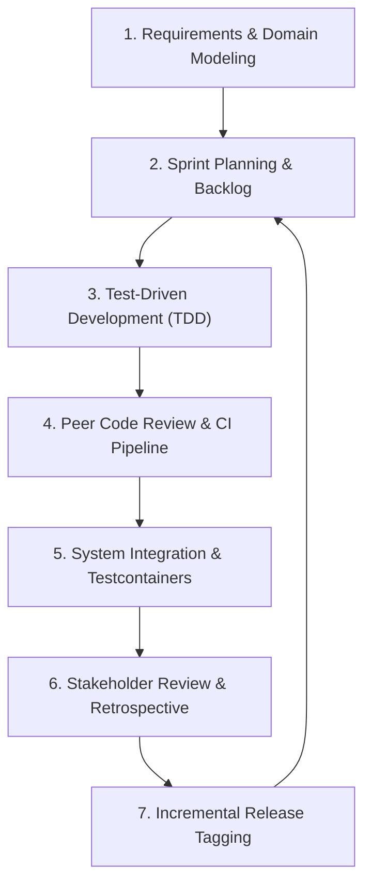

### Sprint Distribution Schedule
* **Iteration 1 (Weeks 1–2):** Domain entity design, database schema, Flyway migrations, and OpenAPI specification.
* **Iteration 2 (Weeks 3–4):** Spring Security integration, JWT token rotation, user profile services, and OTP verification.
* **Iteration 3 (Weeks 5–6):** Property catalog management, multi-file image upload, and PostGIS location indexing.
* **Iteration 4 (Weeks 7–8):** Concurrency-safe booking engine, lease generation workflow, and GiST exclusion locks.
* **Iteration 5 (Weeks 9–10):** Payment gateway integration, escrow lifecycle, invoice generation cron, and late-fee automation.
* **Iteration 6 (Weeks 11–12):** Maintenance ticket SLA engine, rating reviews, end-to-end integration tests, load testing, and deployment.

---

## 11. System Architecture

RentSphere is architected around **Clean Architecture / Hexagonal Architecture** principles:

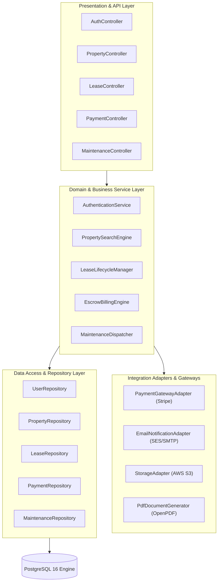

---

## 12. UML and Behavioral Diagrams

### 12.1 Data Flow Diagram (DFD Level 1)

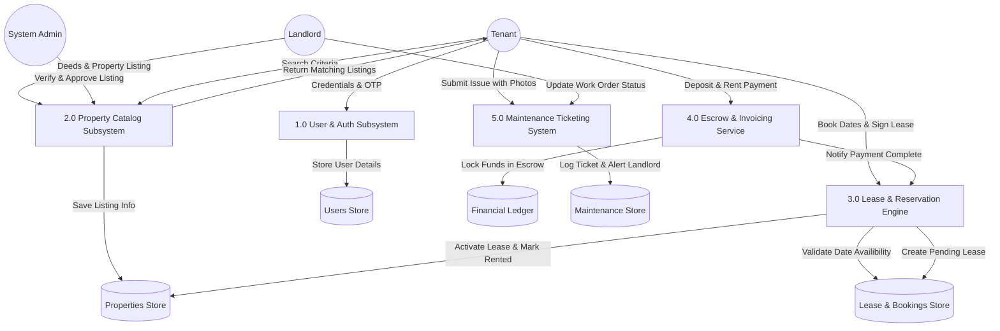

### 12.2 Use Case Diagram

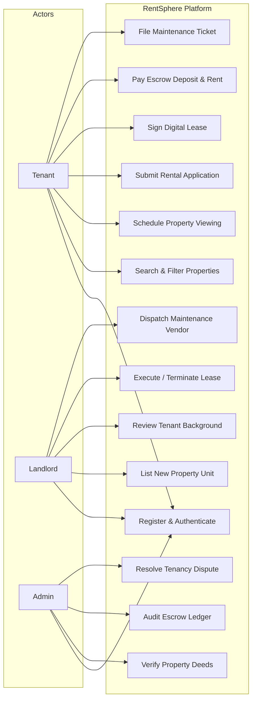

### 12.3 Activity Diagram — Property Booking & Lease Execution

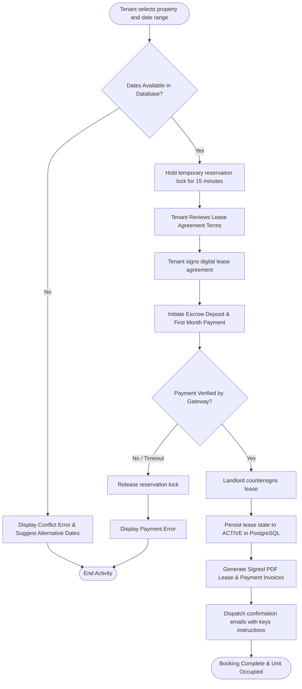

### 12.4 Entity Relationship Diagram (ERD)

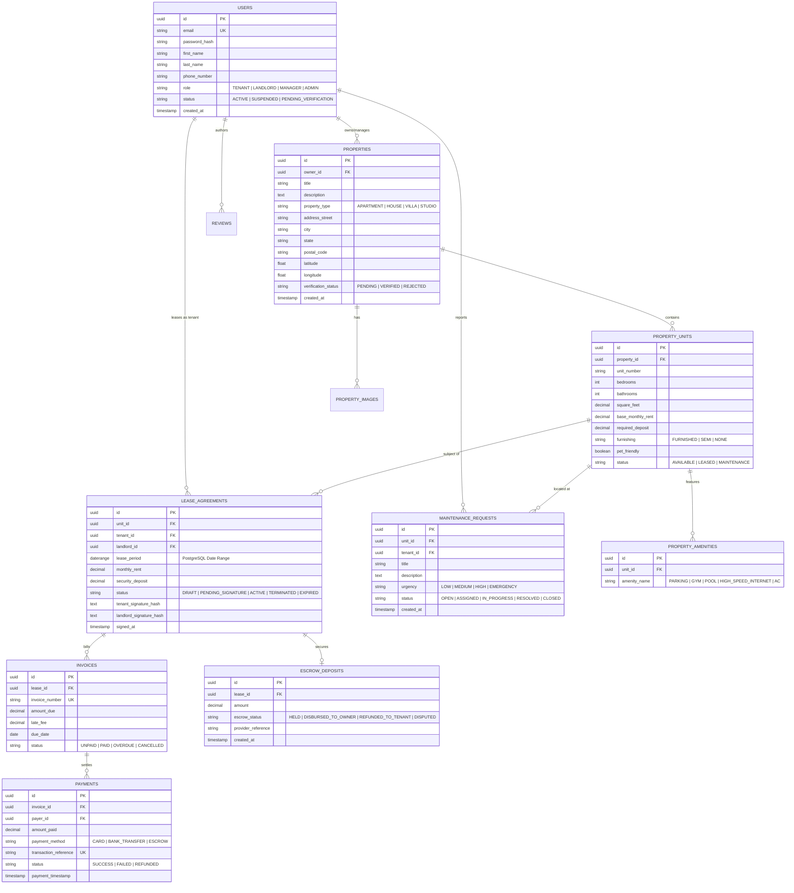

### 12.5 Class Diagram

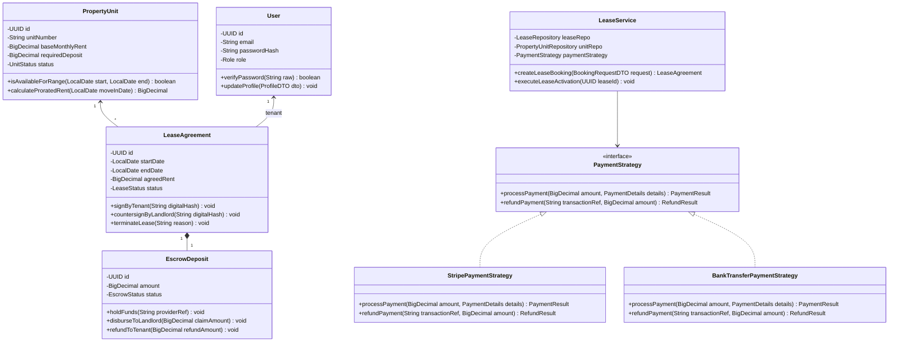

### 12.6 Object Diagram (Runtime Snapshot)

```mermaid
classDiagram
    direction LR

    object "johnTenant : User" {
        id = "f47ac10b-58cc-4372-a567-0e02b2c3d479"
        email = "john.doe@example.com"
        role = "ROLE_TENANT"
        status = "ACTIVE"
    }

    object "apexVillas : Property" {
        id = "b728b493-27c9-4b2e-a0e4-b7781b0a5192"
        title = "Apex Luxury Waterfront Villa"
        city = "Austin"
        verificationStatus = "VERIFIED"
    }

    object "unit101 : PropertyUnit" {
        id = "a1197bc8-99de-4b92-8ec2-7e0fca5c9284"
        unitNumber = "Villa-A"
        bedrooms = 3
        baseMonthlyRent = 2400.00
        status = "LEASED"
    }

    object "activeLease2026 : LeaseAgreement" {
        id = "c3182da9-33ab-412e-9d22-2b3f110c7104"
        leasePeriod = "[2026-11-01, 2027-10-31]"
        monthlyRent = 2400.00
        securityDeposit = 3600.00
        status = "ACTIVE"
    }

    object "escrowAccount : EscrowDeposit" {
        id = "d9910cf1-1192-4911-8ec1-190ab7710214"
        amount = 3600.00
        escrowStatus = "HELD"
        providerReference = "ch_3Nrk10LkdIwHu7ix"
    }

    johnTenant --> activeLease2026 : signs as tenant
    apexVillas --> unit101 : contains
    activeLease2026 --> unit101 : reserves
    activeLease2026 --> escrowAccount : secured by
```

### 12.7 State Machine Diagram — Lease & Booking Lifecycle

```mermaid
stateDiagram-v2
    [*] --> DRAFT : Tenant submits reservation request
    DRAFT --> PENDING_PAYMENT : Landlord approves application
    PENDING_PAYMENT --> PAYMENT_FAILED : Gateway rejects transaction
    PAYMENT_FAILED --> PENDING_PAYMENT : Retry within 24h
    PAYMENT_FAILED --> EXPIRED : 24h timeout elapsed
    
    PENDING_PAYMENT --> PENDING_SIGNATURE : Escrow deposit secured
    PENDING_SIGNATURE --> ACTIVE : Both parties digitally sign
    
    ACTIVE --> UNDER_NOTICE : Tenant / Landlord submits notice to vacate
    UNDER_NOTICE --> INSPECTION_PENDING : Move-out date reached
    INSPECTION_PENDING --> TERMINATED : No damage; Escrow deposit 100% refunded
    INSPECTION_PENDING --> TERMINATED : Damage claimed; Escrow deposit deducted
    
    ACTIVE --> TERMINATED : Mutual breach or eviction order
    
    DRAFT --> CANCELLED : Tenant withdraws request
    EXPIRED --> [*]
    CANCELLED --> [*]
    TERMINATED --> [*]
```

### 12.8 Sequence Diagram — High-Concurrency Booking with Escrow Payment

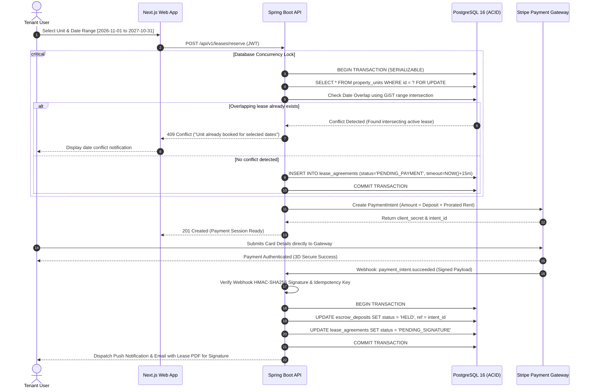

---

## 13. Key Technical Design Decisions

### 13.1 Concurrency & Double-Booking Prevention
In high-demand rental markets, two tenants might click "Book Now" for the same apartment on the same dates simultaneously. Relying on application-level checks (`if (!isBooked)`) causes critical race conditions.

RentSphere implements a **three-tier defensive strategy**:

1. **Pessimistic Row-Level Locking:** During the booking reservation transaction, the unit is locked using `SELECT ... FOR UPDATE`, blocking concurrent sessions until commit.
2. **PostgreSQL GiST Date Range Exclusion Constraints (Database-Level Enforcement):**
   ```sql
   -- PostgreSQL native btree_gist extension ensures zero overlapping intervals
   CREATE EXTENSION IF NOT EXISTS btree_gist;

   ALTER TABLE lease_agreements
   ADD CONSTRAINT exclude_overlapping_active_leases
   EXCLUDE USING gist (
       unit_id WITH =,
       lease_period WITH &&
   )
   WHERE (status IN ('PENDING_PAYMENT', 'PENDING_SIGNATURE', 'ACTIVE'));
   ```
3. **Automated Stress Testing:** High-concurrency integration tests fire 50 simultaneous threads attempting to book the identical unit and date range; exactly one succeeds with `201 Created`, and 49 receive `409 Conflict`.

### 13.2 Dynamic Pricing & Prorated Rent Engine
Properties feature base pricing, but actual checkout requires deterministic adjustment. The engine encapsulates calendar arithmetic:

```java
public class RentCalculator {
    public static BigDecimal calculateProratedFirstMonth(
            BigDecimal monthlyRent, LocalDate moveInDate) {
        
        int daysInMonth = moveInDate.lengthOfMonth();
        int activeDays = daysInMonth - moveInDate.getDayOfMonth() + 1;
        
        if (activeDays == daysInMonth) {
            return monthlyRent; // Full month move-in on the 1st
        }
        
        BigDecimal dailyRate = monthlyRent.divide(
            BigDecimal.valueOf(daysInMonth), 4, RoundingMode.HALF_UP
        );
        
        return dailyRate.multiply(BigDecimal.valueOf(activeDays))
                        .setScale(2, RoundingMode.HALF_UP);
    }
}
```

### 13.3 Escrow Security Deposit & Refund Calculation Engine
RentSphere acts as a neutral fiduciary agent. Deposits are held in an escrow ledger and cannot be withdrawn unilaterally by landlords.

$$\text{Refund Amount} = \text{Held Escrow Deposit} - \left( \sum \text{Itemized Verified Damage Claims} + \text{Unpaid Invoices} \right)$$

Refund calculations are pure functions with injected system clocks, making them $100\%$ unit-testable against lease termination conditions.

### 13.4 Idempotent Webhook & Payment Verification Architecture
Payment gateways may retry webhooks up to 72 hours if network glitches occur. RentSphere enforces strict **idempotent consumption**:
- Every webhook payload contains an event ID (e.g., `evt_1Oq4v2...`).
- An incoming webhook is inserted into an `idempotency_keys` table with a unique constraint. If a duplicate event ID arrives, PostgreSQL immediately throws a unique constraint violation, and the API returns `200 OK` without re-processing payments.

### 13.5 Extensible Gang-of-Four Design Patterns
1. **Strategy Pattern:** Used for interchangeable payment providers (`StripePaymentStrategy`, `PayPalPaymentStrategy`, `MockPaymentStrategy`).
2. **Factory Pattern:** Dynamically constructs notification dispatches (`EmailNotificationFactory`, `SmsNotificationFactory`, `PushNotificationFactory`).
3. **Builder Pattern:** Assembles complex `LeaseAgreement` and `PropertySearchSpecification` entities cleanly without telescoping constructors.
4. **Observer Pattern:** Decouples event triggers (e.g., `OnLeaseSignedEvent` automatically notifies the tenant, alerts the landlord, schedules invoice creation, and regenerates the analytics cache).

### 13.6 Fine-Grained Role & Ownership-Based Authorization
A user authenticated as `ROLE_TENANT` must not be able to query another tenant's lease:

```java
@PreAuthorize("hasRole('ADMIN') or @leaseSecurityService.isPartyToLease(authentication, #leaseId)")
@GetMapping("/{leaseId}")
public ResponseEntity<LeaseResponseDTO> getLeaseDetails(@PathVariable UUID leaseId) {
    return ResponseEntity.ok(leaseService.findById(leaseId));
}
```

---

## 14. Database Design & Integrity Constraints

### Primary Relational Tables
| Table Name | Primary Key | Key Foreign Keys | Storage Purpose |
| :--- | :--- | :--- | :--- |
| `users` | `id` (UUID) | None | Core authentication identities, passwords, roles. |
| `properties` | `id` (UUID) | `owner_id -> users(id)` | Parent physical buildings and estates. |
| `property_units` | `id` (UUID) | `property_id -> properties(id)` | Individual rentable apartments/villas/rooms. |
| `property_images`| `id` (UUID) | `property_id -> properties(id)` | Cloud storage URLs, priority order, captions. |
| `lease_agreements`| `id` (UUID) | `unit_id`, `tenant_id`, `landlord_id` | Tenancy agreements, date intervals, status. |
| `escrow_deposits`| `id` (UUID) | `lease_id -> lease_agreements(id)` | Security deposit fiduciary ledger. |
| `invoices` | `id` (UUID) | `lease_id -> lease_agreements(id)` | Monthly recurring rent dues & late penalties. |
| `payments` | `id` (UUID) | `invoice_id -> invoices(id)` | Financial transaction records and gateway IDs. |
| `maintenance_requests`| `id` (UUID)| `unit_id`, `tenant_id` | Issue tickets, priority tier, resolution state. |

### Relational Integrity & Performance Rules
1. All foreign keys enforce `ON DELETE RESTRICT` for active leases and invoices to ensure non-repudiation of financial histories.
2. Geospatial spatial index: `CREATE INDEX idx_properties_coords ON properties USING GIST (ST_SetSRID(ST_MakePoint(longitude, latitude), 4326));`
3. Composite B-Tree index for search queries: `CREATE INDEX idx_units_price_beds ON property_units (base_monthly_rent, bedrooms, status);`

---

## 15. User Interface Plan & Wireframes

### UI Route Hierarchy (Next.js 14 App Router)
```text
app/
├── (public)/
│   ├── page.tsx                           # Landing page with hero search & featured listings
│   ├── properties/
│   │   ├── page.tsx                       # Dynamic search & map view with filter sidebar
│   │   └── [id]/page.tsx                  # Property details, gallery, tour schedule, amenities
│   ├── login/page.tsx                     # Multi-role authentication & OTP modal
│   └── register/page.tsx                  # Registration selector (Tenant vs Landlord)
├── tenant/
│   ├── dashboard/page.tsx                 # Active lease summary, rent countdown, notices
│   ├── applications/page.tsx              # Application tracker & status badges
│   ├── payments/page.tsx                  # Invoices, escrow deposit receipts, pay modal
│   └── maintenance/page.tsx               # Ticket submission form & status progress bar
├── landlord/
│   ├── dashboard/page.tsx                 # Occupancy rates, Gross revenue, pending actions
│   ├── properties/create/page.tsx         # Multi-step property creation wizard with image upload
│   ├── leases/page.tsx                    # Digital lease generator & signature review
│   └── maintenance/page.tsx               # Ticket dispatch & contractor assignment
└── admin/
    ├── deeds/page.tsx                     # Deed document verification & approval queue
    ├── escrow/page.tsx                    # Platform deposit balances & dispute mediation
    └── users/page.tsx                     # User governance, role assignment, suspensions
```

### Wireframe Sketch: Search & Filter Interface (Tenant View)
```text
┌────────────────────────────────────────────────────────────────────────────────────────┐
│  RentSphere    [Explore Properties]  [My Leases]  [Maintenance]      (🔔) [John Doe ▼] │
├────────────────────────────────────────────────────────────────────────────────────────┤
│ Filters: [City: Austin, TX ▼] [Price: $1000-$3000] [Beds: 2+] [Furnished: [x]] [Search]│
├──────────────────────────────────────────┬─────────────────────────────────────────────┤
│  Listings (42 Available Units)           │  Interactive Map View (Mapbox / Leaflet)    │
│ ┌──────────────────────────────────────┐ │ ┌─────────────────────────────────────────┐ │
│ │ [Image] Villa Serena - Unit 4B       │ │ │                                         │ │
│ │ 2 Beds • 2 Baths • 1,150 sqft        │ │ │           [$2,200]                      │ │
│ │ $2,200 / mo • Available Nov 1st      │ │ │                   [$1,850]              │ │
│ │ ⭐ 4.9 (18 reviews)                   │ │ │                                         │ │
│ │ [ Schedule Tour ]   [ Apply Now ]    │ │ │          [$2,600]        [$3,100]       │ │
│ └──────────────────────────────────────┘ │ │                                         │ │
│ ┌──────────────────────────────────────┐ │ │                                         │ │
│ │ [Image] Downtown Austin Loft - #12   │ │ │                                         │ │
│ │ 1 Bed • 1 Bath • 850 sqft            │ │ │                                         │ │
│ │ $1,850 / mo • Available Immediately  │ │ │                                         │ │
│ │ ⭐ 4.7 (9 reviews)                    │ │ └─────────────────────────────────────────┘ │
│ │ [ Schedule Tour ]   [ Apply Now ]    │ │                                             │
│ └──────────────────────────────────────┘ │ [ Showing 42 properties within 15 miles ]  │
└──────────────────────────────────────────┴─────────────────────────────────────────────┘
```

---

## 16. RESTful API Design Proposal

All routes are versioned under `/api/v1` and follow standard REST semantics.

### 16.1 Authentication Endpoints (`/api/v1/auth`)
| Method | Endpoint | Access | Functionality |
| :--- | :--- | :--- | :--- |
| `POST` | `/register` | Public | Register new Tenant or Landlord profile. |
| `POST` | `/verify-otp` | Public | Validate email verification OTP code. |
| `POST` | `/login` | Public | Authenticate credentials; return JWT access & refresh tokens. |
| `POST` | `/refresh-token` | Public | Issue new access token using secure HTTP-only refresh cookie. |

### 16.2 Property Endpoints (`/api/v1/properties`)
| Method | Endpoint | Access | Functionality |
| :--- | :--- | :--- | :--- |
| `GET` | `/search` | Public | Paginated multi-criteria property search with geospatial bounds. |
| `GET` | `/{id}` | Public | Detailed property metadata with units and amenities. |
| `POST` | `/` | Landlord | Create a new property listing with units. |
| `PATCH`| `/{id}/verify` | Admin | Review deed documents and approve/reject listing. |

### 16.3 Lease & Booking Endpoints (`/api/v1/leases`)
| Method | Endpoint | Access | Functionality |
| :--- | :--- | :--- | :--- |
| `POST` | `/reserve` | Tenant | Attempt lock and create pending lease reservation. |
| `POST` | `/{id}/sign/tenant` | Tenant | Submit digital cryptographic signature on lease. |
| `POST` | `/{id}/sign/landlord`| Landlord | Landlord countersign to complete lease agreement. |
| `GET` | `/{id}/pdf` | Parties | Download legally formatted PDF lease document. |

### 16.4 Escrow & Billing Endpoints (`/api/v1/billing`)
| Method | Endpoint | Access | Functionality |
| :--- | :--- | :--- | :--- |
| `POST` | `/checkout-session` | Tenant | Create gateway payment intent for deposit/rent. |
| `POST` | `/webhook` | Gateway | Idempotent payment webhook listener. |
| `GET` | `/invoices/me` | Tenant | Fetch list of unpaid and paid monthly invoices. |

### 16.5 Maintenance Endpoints (`/api/v1/maintenance`)
| Method | Endpoint | Access | Functionality |
| :--- | :--- | :--- | :--- |
| `POST` | `/` | Tenant | Create maintenance ticket with multipart image uploads. |
| `PATCH`| `/{id}/status` | Landlord | Transition ticket status (`ASSIGNED`, `RESOLVED`, etc.). |

### Example Contract: High-Concurrency Reservation Request
**Request:** `POST /api/v1/leases/reserve`
```json
{
  "unitId": "a1197bc8-99de-4b92-8ec2-7e0fca5c9284",
  "startDate": "2026-11-01",
  "endDate": "2027-10-31",
  "numberOfOccupants": 2,
  "agreeToBackgroundCheck": true
}
```

**Success Response:** `201 Created`
```json
{
  "leaseId": "c3182da9-33ab-412e-9d22-2b3f110c7104",
  "status": "PENDING_PAYMENT",
  "unitNumber": "Villa-A",
  "monthlyRent": 2400.00,
  "proratedFirstMonthRent": 2400.00,
  "securityDeposit": 3600.00,
  "totalAmountDueNow": 6000.00,
  "reservationExpiresAt": "2026-10-31T09:45:00Z",
  "checkoutUrl": "https://checkout.stripe.com/pay/cs_test_a1b2c3d4..."
}
```

**Conflict Response (Double Booking Prevented):** `409 Conflict`
```json
{
  "timestamp": "2026-10-31T09:30:12Z",
  "status": 409,
  "error": "RESERVATION_CONFLICT",
  "message": "The selected unit is already leased or reserved between 2026-11-01 and 2027-10-31.",
  "path": "/api/v1/leases/reserve"
}
```

---

## 17. Project Schedule and Gantt Chart

The project follows a 12-week comprehensive engineering lifecycle.

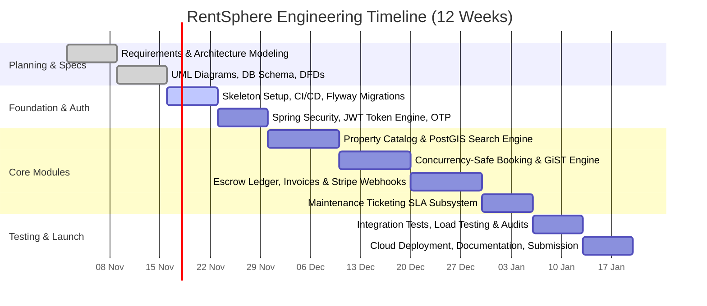

---

## 18. Milestones and Deliverables

| Milestone | Target Week | Deliverables & Acceptance Criteria |
| :--- | :---: | :--- |
| **M1: Specification Sign-off** | Week 2 | Complete SRS document, UML diagrams (DFD, Use Case, Sequence, ERD), Gantt chart. |
| **M2: Architecture Baseline** | Week 4 | Working Spring Boot 3 + Next.js repository, Flyway DDL migrations running on PostgreSQL. |
| **M3: Identity & Property Engine** | Week 6 | Multi-role JWT authentication, Landlord property listing wizard, PostGIS search API. |
| **M4: Transactional Booking Engine**| Week 8 | Zero-collision GiST booking verification, reservation holds, dynamic proration engine. |
| **M5: Financial Escrow & Invoicing**| Week 10 | Escrow deposit flow, recurring invoice cron job, Stripe webhook signature verifier. |
| **M6: Final Quality Gate & Release**| Week 12 | Tested build ($>85\%$ coverage), Docker Compose setup, user documentation, final presentation. |

---

## 19. Testing Strategy & Traceability Matrix

### Testing Tiers
- **Unit Testing (JUnit 5 + Mockito):** Pure business logic tests (prorated rent calculations, refund eligibility, lease date validation).
- **Integration Testing (Spring Boot `@SpringBootTest` + Testcontainers):** Real PostgreSQL container instances test repository queries and GiST exclusion locks.
- **Concurrency Testing:** Java `ExecutorService` and `CountDownLatch` launch 50 simultaneous threads booking the identical unit.
- **Frontend E2E Testing (Playwright):** Browser automation tests the complete tenant booking and payment flow.

### Sample Test Case Specifications
| Test ID | Test Scenario | Input Data | Expected Result |
| :--- | :--- | :--- | :--- |
| **TC-01** | Prorated rent on mid-month move-in | Rent: \$1500, Move-in: Oct 18 (31-day month) | Prorated amount equals exactly **\$677.42**. |
| **TC-02** | Simultaneous double-booking attack | 50 concurrent threads requesting same Unit & dates | Exactly **1 thread succeeds (201)**; **49 fail (409 Conflict)**. |
| **TC-03** | Replayed payment webhook attack | Same Stripe event ID sent twice | 1st executes; 2nd returns **200 OK without double crediting**. |
| **TC-04** | Unauthorized lease retrieval | Tenant A requests `/api/v1/leases/{tenantB_LeaseId}` | Access denied with **403 Forbidden**. |
| **TC-05** | Lease duration boundary check | Lease requested for 15 days (below 1-month min) | Validation exception thrown with **400 Bad Request**. |

---

## 20. Security, Privacy, and Compliance

1. **Authentication:** Stateless JSON Web Tokens (JWT) signed with RSA-256 private/public key pairs. Tokens carry short 15-minute validity; refresh tokens are stored in `HttpOnly`, `SameSite=Strict`, `Secure` cookies.
2. **Data Protection & Privacy:** Tenant government IDs and background checks are encrypted at rest using AES-256 (GCM mode).
3. **OWASP Top 10 Defenses:**
   - **SQL Injection:** Zero raw string concatenation; all queries use Spring Data JPA parameterized statements.
   - **Cross-Site Scripting (XSS):** React auto-escapes rendered text; restrictive `Content-Security-Policy` header.
   - **Broken Object-Level Authorization (BOLA):** Service methods strictly verify that the authenticated principal ID matches the resource's owner or tenant ID.
4. **Audit Logging:** Every financial transaction, status transition, and administrative intervention is recorded in an immutable append-only `audit_logs` table.

---

## 21. Setup and Local Development Configuration

### Prerequisites
- **Java Development Kit (JDK 21 LTS)** installed (`java --version`)
- **Node.js (v20+ LTS)** and **npm** (`node -v`)
- **Docker & Docker Compose** (for PostgreSQL and Redis containers)
- **Apache Maven 3.9+** (`mvn -v`)

### Quick-Start Execution Guide

```bash
# 1. Clone the repository
git clone https://github.com/your-username/rentsphere-house-rental.git
cd rentsphere-house-rental

# 2. Launch PostgreSQL 16 & Redis via Docker
docker compose up -d

# 3. Build & launch the Spring Boot API backend
cd backend
mvn clean install -DskipTests
mvn spring-boot:run
# Backend will be available at http://localhost:8080

# 4. In a separate terminal, launch the Next.js frontend
cd ../frontend
npm install
npm run dev
# Frontend will be live at http://localhost:3000
```

---

## 22. Environment Variables Specification

| Variable Name | Description | Default / Example Value |
| :--- | :--- | :--- |
| `SPRING_PROFILES_ACTIVE` | Active Spring profile | `dev` or `prod` |
| `SPRING_DATASOURCE_URL` | PostgreSQL JDBC connection URL | `jdbc:postgresql://localhost:5432/rentsphere_db` |
| `SPRING_DATASOURCE_USERNAME` | Database connection username | `rentsphere_admin` |
| `SPRING_DATASOURCE_PASSWORD` | Database connection password | *(Set securely in local env)* |
| `JWT_PRIVATE_KEY` | PEM-encoded RSA Private Key | *(File path or Base64 secret)* |
| `JWT_PUBLIC_KEY` | PEM-encoded RSA Public Key | *(File path or Base64 secret)* |
| `STRIPE_API_KEY` | Stripe secret API key | `sk_test_51Mz...` |
| `STRIPE_WEBHOOK_SECRET` | Stripe webhook signing secret | `whsec_9b2a...` |
| `AWS_S3_BUCKET_NAME` | S3 bucket for lease PDFs & photos | `rentsphere-property-assets` |
| `NEXT_PUBLIC_API_BASE_URL` | Frontend REST API base endpoint | `http://localhost:8080/api/v1` |

---

## 23. Repository Directory Structure

```text
rentsphere-house-rental/
├── .github/
│   └── workflows/
│       ├── backend-ci.yml                 # Automated Maven test & build pipeline
│       └── frontend-ci.yml                # Linting, TypeScript checks, and Playwright E2E
├── docker-compose.yml                     # Local PostgreSQL 16 & Redis 7 services
├── backend/
│   ├── pom.xml                            # Maven dependencies & build plugins
│   ├── src/
│   │   ├── main/
│   │   │   ├── java/com/rentsphere/
│   │   │   │   ├── RentSphereApplication.java
│   │   │   │   ├── config/                # SecurityConfig, RedisConfig, WebMvcConfig
│   │   │   │   ├── security/              # JwtFilter, UserPrincipal, TokenProvider
│   │   │   │   ├── domain/                # JPA Entities (User, Property, Lease, Invoice)
│   │   │   │   ├── repository/            # Spring Data JPA Interfaces
│   │   │   │   ├── service/               # Business Logic & Dynamic Calculators
│   │   │   │   ├── patterns/              # Strategy, Factory, Observer implementations
│   │   │   │   ├── controller/            # REST API @RestControllers
│   │   │   │   ├── dto/                   # Request & Response Data Transfer Objects
│   │   │   │   └── exception/             # GlobalExceptionHandler (@ControllerAdvice)
│   │   │   └── resources/
│   │   │       ├── application.yml        # Spring application properties
│   │   │       └── db/migration/          # Flyway SQL scripts (V1__init.sql, V2__indexes.sql)
│   │   └── test/                          # Unit, Integration & Concurrency Test suites
├── frontend/
│   ├── package.json
│   ├── tsconfig.json
│   ├── tailwind.config.ts
│   ├── src/
│   │   ├── app/                           # Next.js 14 App Router pages & layouts
│   │   ├── components/                    # Reusable UI primitives (Buttons, Modals, Forms)
│   │   ├── hooks/                         # Custom React hooks (useAuth, useLease)
│   │   ├── lib/                           # Axios instance, formatting utils, validators
│   │   └── types/                         # TypeScript interface contracts matching DTOs
└── docs/
    ├── srs-specification.pdf              # Formal course report document
    └── diagrams/                          # High-resolution exported diagram assets
```

---

## 24. Risk Analysis and Mitigation Matrix

| Identified Risk | Likelihood | Impact | Proactive Mitigation Strategy |
| :--- | :---: | :---: | :--- |
| **Race Conditions on Popular Properties** | High | Severe | PostgreSQL GiST exclusion constraints enforce physical serialization of booking date ranges. |
| **Stripe Webhook Delivery Failures** | Medium | High | Webhooks are idempotent; a backup Spring `@Scheduled` job polls Stripe every 30 minutes for unsettled sessions. |
| **Fraudulent Property Listings** | Medium | Severe | Landlords must upload municipal property deeds; listings remain `PENDING_VERIFICATION` until Admin approval. |
| **Tenant Refusal to Vacate Upon Expiry** | Low | High | Legally binding digital lease agreements with audit logs and timestamped digital signatures enable streamlined legal recourse. |

---

## 25. Learning Outcomes and Competencies

This project delivers comprehensive demonstration of core Software Engineering and Project Management competencies:

| Software Engineering Competency | Demonstration in RentSphere |
| :--- | :--- |
| **Requirements Engineering** | Formal SRS structure, measurable functional (FR) & non-functional (NFR) specs, and traceability matrix. |
| **Architectural Modeling** | Layered clean architecture, DFDs (Level 0/1), Use Case diagrams, and State Machine diagrams. |
| **Advanced Database Engineering** | PostgreSQL GiST range indexes, PostGIS geospatial points, ACID transactions, and versioned Flyway migrations. |
| **Design Patterns & OOP** | Applied GoF patterns (Strategy for payments, Factory for alerts, Builder for leases, Observer for lifecycle events). |
| **Concurrency & Enterprise Security**| Thread-safe pessimistic locks, RS256 stateless JWT authentication, and OWASP Top 10 vulnerability hardening. |
| **Project Management** | 12-week Agile sprint plan, Gantt chart milestone tracking, and quantitative risk matrix. |

---

## 26. Future Enhancements

- 🗺️ **3D Virtual Tours:** Integration with Matterport 3D APIs for immersive virtual property walk-throughs.
- 🤖 **AI Rent Price Valuation:** Machine Learning model trained on local municipal data to recommend optimal pricing to landlords based on season and amenities.
- 📱 **Mobile Native Apps:** Cross-platform React Native / Flutter apps with push notifications for instant lease updates.
- ⚡ **Smart Keyless Access:** IoT integration with smart lock providers (Yale, August) to issue time-limited digital door codes to tenants during lease duration.

---

## 27. Conclusion

**RentSphere** provides an exhaustive, industry-grade blueprint for modern residential property leasing. By synthesizing a **Next.js 14** web application, a **Java 21 / Spring Boot 3** REST backend, and **PostgreSQL 16** with range-exclusion concurrency guarantees, the project solves real-world housing friction while demonstrating mastery of requirements engineering, system design, architectural modeling, concurrency safety, and modern software development practices.
