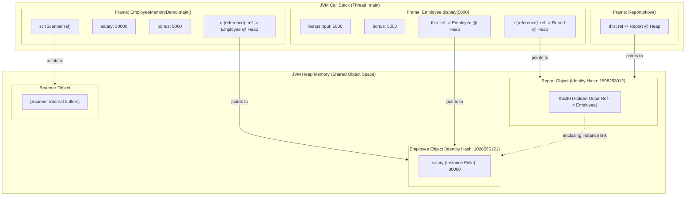
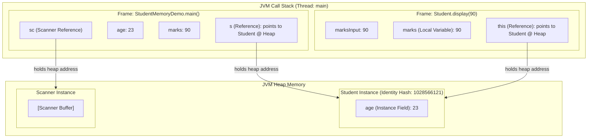

# Lab Practice: Java Memory Management (Stack vs. Heap Architecture)

[](https://www.oracle.com/java/)
[](#)
[](#)

---

## Table of Contents
1. [Overview & Objectives](#1-overview--objectives)
2. [Experiment 1: Employee Memory Demonstration](#2-experiment-1-employeememorydemo)
   - [Source Code](#21-source-code-employeememorydemojava)
   - [Input Data](#22-test-inputs)
   - [Program Execution Output](#23-program-execution-output)
   - [Terminal Screenshot](#24-terminal-screenshot)
   - [JVM Memory Layout & Architecture Diagram](#25-jvm-memory-architecture-diagram)
   - [In-Depth Memory Mechanism Analysis](#26-in-depth-memory-mechanism-analysis)
3. [Experiment 2: Student Memory Demonstration](#3-experiment-2-studentmemorydemo)
   - [Source Code](#31-source-code-studentmemorydemojava)
   - [Input Data](#32-test-inputs)
   - [Program Execution Output](#33-program-execution-output)
   - [Terminal Screenshot](#34-terminal-screenshot)
   - [JVM Memory Layout & Architecture Diagram](#35-jvm-memory-architecture-diagram)
   - [In-Depth Memory Mechanism Analysis](#36-in-depth-memory-mechanism-analysis)
4. [Comparative Memory Analysis: Stack vs. Heap](#4-comparative-memory-analysis-stack-vs-heap)
5. [Observations & Theoretical Conclusions](#5-observations--theoretical-conclusions)
6. [Canvas & GitHub Submission Guidelines](#6-canvas--github-submission-guidelines)

---

## 1. Overview & Objectives

In Java, understanding how the **Java Virtual Machine (JVM)** manages runtime data areas is fundamental for developing high-performance, bug-free applications. This lab investigates:

- **JVM Stack Memory:** Thread-confined execution memory storing method call frames, local primitive variables, and references to heap objects.
- **JVM Heap Memory:** Shared runtime memory pool where all class instances (objects) and their instance fields are allocated.
- **Variable Lifetime & Scope:** Contrasting instance fields (bound to object lifespan on the heap) with local method variables (bound to stack frame lifecycle).
- **Identity Hash Codes:** Inspecting `System.identityHashCode()` to verify object identity and distinct physical allocations in heap space.
- **Local Inner Classes:** Exploring method-scoped class definitions and nested execution frames.

---

## 2. Experiment 1: EmployeeMemoryDemo

### 2.1 Source Code (`EmployeeMemoryDemo.java`)

```java
import java.util.Scanner;

public class EmployeeMemoryDemo {
    public static void main(String[] args) {
        Scanner sc = new Scanner(System.in);

        System.out.print("Enter salary: ");
        int salary = sc.nextInt();
        System.out.print("Enter bonus: ");
        int bonus = sc.nextInt();
        System.out.println();

        Employee e = new Employee(salary);   // 'e' -> stack of main(); object -> heap
        System.out.println("Employee Object Created");
        System.out.println("Employee Identity Hash Code: " + System.identityHashCode(e));
        System.out.println();

        e.display(bonus);

        System.out.println();
        System.out.println("Memory Concept:");
        System.out.println("Employee object -> Heap");
        System.out.println("Report object -> Heap");
        System.out.println("salary -> Instance field");
        System.out.println("bonus -> Local variable in display()");
        System.out.println("show() -> Executes in its own method frame");

        sc.close();
    }
}

// Heap object: each Employee object (with its 'salary' field) lives on the heap.
class Employee {
    int salary;                    // instance variable -> inside the object on the heap

    Employee(int salary) {
        this.salary = salary;
    }

    void display(int bonusInput) {
        int bonus = bonusInput;    // local variable -> in display()'s stack frame

        System.out.println("Inside display() Method:");
        System.out.println("Salary (Instance Variable): " + salary);
        System.out.println("Bonus (Local Variable): " + bonus);
        System.out.println();

        // Local inner class: declared inside the method
        class Report {
            void show() {
                // show() runs in its own stack frame
                System.out.println("Report: Employee salary is " + salary);
            }
        }

        Report r = new Report();   // Report object -> heap; 'r' (reference) -> display()'s stack frame
        System.out.println("Report Object Created");
        System.out.println("Report Identity Hash Code: " + System.identityHashCode(r));
        r.show();
    }
}
```

### 2.2 Test Inputs

| Variable Name | Variable Type | Input Value | Scope / Location |
| :--- | :--- | :--- | :--- |
| `salary` | Primitive `int` | `30000` | Local variable in `main()`, then initialized as instance field `Employee.salary` |
| `bonus` | Primitive `int` | `5000` | Local variable in `main()`, passed into `display(int bonusInput)` |

### 2.3 Program Execution Output

```text
PS C:\Users\AC\Desktop\3.1 Java\Stack & Heap> javac EmployeeMemoryDemo.java
PS C:\Users\AC\Desktop\3.1 Java\Stack & Heap> java EmployeeMemoryDemo
Enter salary: 30000
Enter bonus: 5000

Employee Object Created
Employee Identity Hash Code: 1028566121

Inside display() Method:
Salary (Instance Variable): 30000
Bonus (Local Variable): 5000

Report Object Created
Report Identity Hash Code: 1808253012
Report: Employee salary is 30000

Memory Concept:
Employee object -> Heap
Report object -> Heap
salary -> Instance field
bonus -> Local variable in display()
show() -> Executes in its own method frame
```

### 2.4 Terminal Screenshot


### 2.5 JVM Memory Architecture Diagram

The diagram below illustrates the exact runtime state when execution is inside `Report.show()`:



### 2.6 In-Depth Memory Mechanism Analysis

1. **Heap Allocation of `Employee` Object:**
   - The expression `new Employee(salary)` allocates contiguous memory on the JVM Heap.
   - The heap object stores object metadata (Mark Word, Klass Word) and the instance field `int salary = 30000`.
   - The reference variable `e` is stored in the local variable array of `main()`'s stack frame, holding the 64-bit reference address pointing to heap memory.
   - Verified via `System.identityHashCode(e) = 1028566121`.

2. **Stack Frame Creation for `display()`:**
   - Calling `e.display(bonus)` pushes a new stack frame onto the Call Stack.
   - `bonusInput` (5000) and `bonus` (5000) exist strictly inside `display()`'s local variable array on the stack.
   - When `display()` finishes, its stack frame is popped off, and `bonus` immediately ceases to exist without requiring Garbage Collection.

3. **Local Inner Class `Report` & Heap Allocation:**
   - `Report` is declared inside `display()`. When instantiated via `new Report()`, an independent object is created on the heap.
   - Verified via its distinct identity hash code: `1808253012`.
   - Because `Report` is a non-static inner class, the Java compiler automatically synthesizes a hidden reference `this$0` pointing back to the enclosing `Employee` instance on the heap, allowing `Report.show()` to access `salary`.

4. **Stack Frame Creation for `show()`:**
   - Invoking `r.show()` pushes a separate frame onto the stack. Its `this` reference points to the `Report` object on the heap.

---

## 3. Experiment 2: StudentMemoryDemo

### 3.1 Source Code (`StudentMemoryDemo.java`)

```java
import java.util.Scanner;

public class StudentMemoryDemo {
    public static void main(String[] args) {
        Scanner sc = new Scanner(System.in);

        System.out.print("Age: ");
        int age = sc.nextInt();
        System.out.print("Marks: ");
        int marks = sc.nextInt();
        System.out.println();

        Student s = new Student(age);  // 's' (reference) -> stack of main(); object -> heap
        s.display(marks);

        sc.close();
    }
}

// Heap object: each Student object (with its 'age' field) lives on the heap.
class Student {
    int age;                       // instance variable -> stored inside the object on the heap

    Student(int age) {
        this.age = age;
    }

    void display(int marksInput) {
        int marks = marksInput;    // local variable -> lives in display()'s stack frame

        System.out.println("Student Object Created");
        System.out.println("Object Identity Hash Code: " + System.identityHashCode(this));
        System.out.println("Instance Variable (age): " + age);
        System.out.println("Local Variable (marks): " + marks);
    }
}
```

### 3.2 Test Inputs

| Variable Name | Variable Type | Input Value | Scope / Location |
| :--- | :--- | :--- | :--- |
| `age` | Primitive `int` | `23` | Read in `main()`, stored as instance variable `Student.age` on Heap |
| `marks` | Primitive `int` | `90` | Read in `main()`, passed as argument to `display(int marksInput)` on Stack |

### 3.3 Program Execution Output

```text
PS C:\Users\AC\Desktop\3.1 Java\Stack & Heap> javac StudentMemoryDemo.java
PS C:\Users\AC\Desktop\3.1 Java\Stack & Heap> java StudentMemoryDemo
Age: 23
Marks: 90

Student Object Created
Object Identity Hash Code: 1028566121
Instance Variable (age): 23
Local Variable (marks): 90
```

### 3.4 Terminal Screenshot


---

### 3.5 JVM Memory Architecture Diagram



### 3.6 In-Depth Memory Mechanism Analysis

1. **Object Allocation & Identity Hash Code:**
   - Instantiation `new Student(23)` reserves heap space for the `Student` object.
   - The reference `s` in `main()` holds the pointer to this instance.
   - `System.identityHashCode(this)` inside `display()` returns `1028566121`, matching the default memory-derived identity representation computed by the HotSpot JVM.

2. **Instance Field vs. Local Variable Lifetime:**
   - `age` is an **instance variable**: It resides directly within the heap memory chunk allocated for the `Student` instance. It remains alive as long as `s` (or any valid reference) points to the object.
   - `marks` is a **local variable**: It is created in the local variable array of `display()`'s stack frame. As soon as `display()` completes execution, the frame is popped and discarded from the call stack.

---

## 4. Comparative Memory Analysis: Stack vs. Heap

| Parameter | JVM Stack Memory | JVM Heap Memory |
| :--- | :--- | :--- |
| **Storage Target** | Method call frames, primitive local variables (`int bonus`, `int marks`), and object references (`e`, `s`, `r`). | Actual class instances/objects (`Employee`, `Student`, `Report`) and all instance fields (`salary`, `age`). |
| **Thread Accessibility** | Strictly **Thread-private**. Each thread has its own call stack; no thread can access another thread's stack frames. | **Thread-shared**. Accessible to all active threads across the JVM. |
| **Allocation Mechanism** | Contiguous LIFO (Last-In, First-Out). Pushed upon method invocation, popped upon method return. | Dynamic allocation managed by the JVM Garbage Collector (e.g., G1GC, ZGC). |
| **Deallocation Cost** | **Zero GC overhead**. Stack frame pointers are simply adjusted when a function returns. | Requires Garbage Collector tracing, marking, sweeping, and memory compaction. |
| **Error Modes** | `java.lang.StackOverflowError` (e.g., deep or infinite recursion). | `java.lang.OutOfMemoryError: Java heap space` (e.g., memory leaks, high volume allocations). |
| **Identity Verification** | Stack variables do not have identity hash codes; they are raw values or pointers. | Objects have unique identity addresses verifiable via `System.identityHashCode(obj)`. |

---

## 5. Observations & Theoretical Conclusions

1. **Separation of References and Objects:**
   - In Java, reference variables (`e`, `s`, `r`, `sc`) are references stored in stack frames. They do NOT contain the object's payload; they hold memory pointers to the heap.
2. **Deterministic Stack vs. Non-Deterministic Heap Lifecycles:**
   - Stack memory allocation and deallocation are strictly deterministic: entering a block/method creates frame slots; exiting automatically destroys them.
   - Heap memory lives beyond method returns. An object persists until it is no longer reachable from any GC Root (roots include active stack references, static variables, or JNI references).
3. **Inner Class Object Independence:**
   - A method-local inner class like `Report` generates a distinct `.class` file (`Employee$1Report.class`) and instantiates an independent heap object (`hash: 1808253012`), confirming that classes declared inside methods still produce regular heap-managed objects.

---

## 6. Canvas & GitHub Submission Guidelines

When submitting this lab directory to GitHub and Canvas:
1. Ensure the directory contains:
   - `EmployeeMemoryDemo.java`
   - `StudentMemoryDemo.java`
   - `employee_memory_output.png`
   - `student_memory_output.png`
   - `README.md`
2. Canvas Submission:
   - **GitHub Repository URL:** `https://github.com/<your-username>/<repo-name>`
   - **Lab Directory Path:** `Stack_Heap_Memory_Demo`
   - **Submission Document:** Export this Markdown document or compiled PDF with the terminal output screenshots attached.
